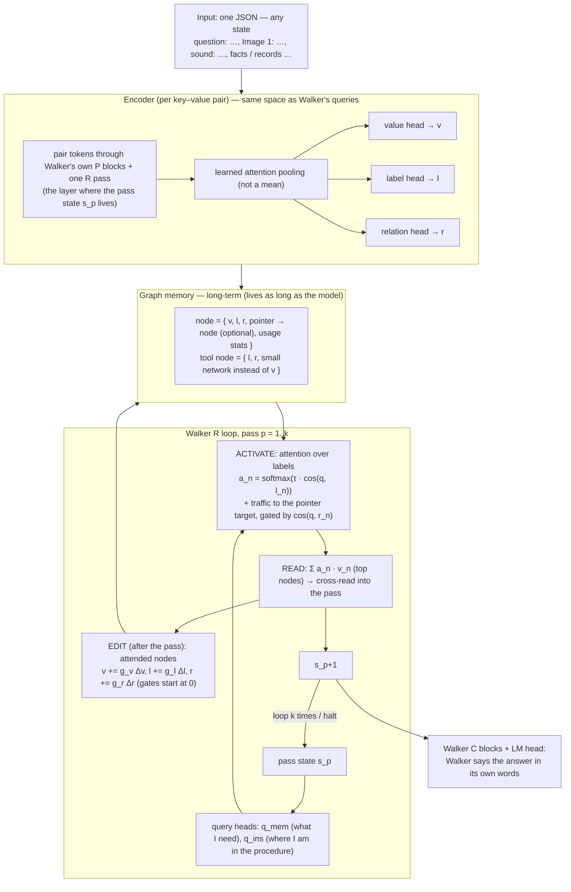

# Graph Node Memory module (GNM) — design v2 (authoritative)

Agreed with the user 2026-10-13. **This file is the only current description.** Earlier mechanics,
runs and bugs are in `docs/GNM_history.md` (superseded where they differ from this file).
Naming: **GNM** = this memory module. **Walker** = only the 1B LM.

---

## 1. Design



### 1.1 What a node has

| field | kind | meaning |
|---|---|---|
| **v** value | vector (D) | the information |
| **l** label | vector (D) | **learned**: what this is, how / when to use it. The only thing queries match. |
| **r** relation | vector (D) | learned: whether to pass activation along the pointer, for this query |
| pointer | node index (optional) | the node this one refers to (set at ingestion: JSON nesting / references) |
| usage stats | scalars | use count, keep strength (capacity, forgetting) |

Tool node: l, r + a small network instead of v. All of v, l, r are produced by the encoder and are
**editable** by the model afterwards.

### 1.2 How it queries (each recurrent pass)
1. Walker's pass state `s_p` → `q_mem`, `q_ins`.
2. Pick by label: `a_n = softmax(τ · cos(q, l_n))` (learned τ); `q_ins` over instruction nodes, NEXT
   pointers carry the procedure forward.
3. Traffic: an active node passes activation to its pointer target, scaled by `σ(cos(q, r_n))`.
4. Read: top nodes' values, weighted, cross-read into the pass (Walker sees vectors, not tokens).
5. Edit: attended nodes' v, l, r get gated deltas from `s_p`.
6. k passes (or halt); Walker's own head speaks the answer.

### 1.2.1 The relation vector is an **edge feature**, not friction (v2.1, `NodeMemV2`)
`r_n` must not be a redundant query gate. Besides `σ(τ_r·cos(q, r_n))` on the nesting edges, the module
adds **two learned, directed adjacencies** (both strict no-ops at init; opened only by training):

**(a) relation-similarity edges** — "r_i and r_j together say how i and j relate" (ownership, inverse /
"opposite", neighbour), connecting nodes the fixed nesting edges never link:

    A_ij = (ea(r_i) · eb(r_j)) / √D        reladj = softmax_j A_ij

**(b) conditional dependence edges** — the target of a node is a **conditional function of its owner and
its relation** (TransE-style), so change the owner and the target moves with it:

    pred_k = V[owner(k)] + rop(r_k)        opadj = softmax_j ⟨pred_k, V[j]⟩

Activation then flows along both: `s_j += w_edge·Σ_i c_i·reladj_ij + w_op·Σ_i c_i·opadj_ij`. The
dependence edges give the walk along value edges a learned conditional map (owner + r → the entity it
refers to) instead of the rule-made pointer — the missing "edge for the hop" (history §1). All of
`ea/eb/w_edge`, `rop/tau_o/w_op` are ordinary `NodeMemV2` parameters. They are **bitwise no-ops at init**
(`w_edge = w_op = 0`), so existing runs/checkpoints are unchanged; gradients flow from the node CE (a
mass-sum objective is invariant and gives them none — use a node-selective loss). The same is mirrored in
the non-v2 `NodeMemory`. `gnm_lm` passes `V` into `activate_batch` so the operator can see the value space.

### 1.3 Vector types per module
| module | vectors |
|---|---|
| encoder | per pair: token states → 3 outputs (v, l, r) |
| node | 3 (v, l, r) + pointer index + scalars |
| tool node | 2 (l, r) + network |
| Walker per pass | state s_p (2048), 2 queries (D), read (D → 2048), 3 edit deltas |

### 1.4 JSON
Any JSON: each `key: value` pair is a node; a nested object is a record node whose pairs point to it;
array elements are nodes pointing to the parent (index in the key); references become pointers;
numbers / booleans / text are encoded as the pair's text. Image / sound values need their own
encoder projected into the same space (not built). The question is itself a pair in the input JSON
(it lives in memory; Walker is not given it directly).

### 1.5 Rules (user)
- Matching is by **learned label vectors** (cosine attention). No hand rules such as word overlap.
- The question lives in memory; Walker is not handed the question.
- Walker turns what it reads into fluent language and pieces ideas together (no copy pointer).
- k = recurrent passes per question; N = parallel rollouts of one question, learn from the best (RL-like).
- KISS; combined runs, not sweeps; uploads only via `molab_upload/`; never connect MoLab to the local
  computer.

## 2. Known vulnerabilities (to handle while building)
1. **Encoder–query space mismatch** (root cause of the old failures): labels came from final-layer
   mean-pooled states, queries from mid-layer pass states. v2 encodes with the same Walker blocks.
2. **Stale vectors** in long-term memory as heads train → store token states; recompute v/l/r with
   the current heads (idle refresh).
3. **Cold start under answer-only** (old B1 = 0) → aligned space, N rollouts, per-pass targets where
   the data has them.
4. **Crowding** (many near-identical labels) → learned τ, candidate stage, pointer traffic; an ANN
   index for very large memories.
5. **Edits that corrupt** long-term memory → bounded gated deltas, only attended nodes, keep the
   original encoding to restore, usage stats; cross-episode effects of an edit are not trainable by
   backprop.
6. **Pointers from free text** need resolution; design-consistent: the model's `link` tool by value
   cosine (exact-name rules are a stopgap).
7. **Walker must learn to read vectors** (frozen; gate starts at 0) → train the read path, maybe a small
   adapter; keep the no-harm KL check.
8. **When to stop** → soft halting over passes or Walker's halt rule.
9. **Operations** (compare / count / sum) → tool nodes in the pairing.
10. **Cost** → encode once, store states; do not re-encode the whole memory every step.

## 3. Build order (each step tested answer-only, no word overlap)
1. **Aligned encoder over the whole JSON document** (P + one R pass, span attention pooling, v / l / r
   heads) + cosine label attention + relation-gated pointer traffic. ← **built** (`gnm_v2.py`, `gnm_lm_1b.py --v2`, tests 48). The query
   heads start as the label head applied to the pass state (`tie_queries`), so q and l share a space at
   step 0. Runs (synthetic procedures task, question in memory, no word overlap): **V1** = per-pass
   targets (can v2 labels learn at all?), **V2** = answer-only (the real test).
   Step 450: V1 per-pass loss 7.25 → 7.10 (barely moving), fact found 0.0 after the question, held-out
   .04; V2 same (.04). Question found 1.0 in both. If V1 is still flat at 1000: stop, probe the label
   space untrained (does a question naming X rank X's label first by cosine? what does pooling see —
   it starts as a mean).
   **Probe (user: "is gradient even flowing?")** — gradient reached the heads, but two bugs in my v2:
   (1) labels of different nodes had cosine .970 (Walker's shared direction; the per-feature
   standardization of the old encoder was missing); (2) cosine scores are all positive (~+9.7), so
   pointer traffic summed children into parents (+24 per record) and swamped even the question search
   (question found 0.0, so the per-pass loss was cut after pass 1 and the value head got 0 gradient).
   Fixes: running per-feature standardization of token states; traffic passes only above-average
   (centered) activation. After: label cosine between nodes .017, question found 1.0, value-head
   gradient 21. V1 / V2 relaunched (old logs `V*_1b_v0.log`).
   **Step-by-step trace (user: "log every step, find the bug").** With per-pass targets, pass 1 finds
   the question (rank 1) but from pass 2 activation is ~uniform (max .006) and the asked person's record
   ranks ~230 of ~350. Found: (a) the query could not carry what was just read into label space → added
   `qr` / `qi` (next query from the read nodes' pooled states, starting as the label head); (b) traffic
   clamp gave below-average nodes zero gradient → softplus; (c) **root cause: each node was encoded
   alone**, so "neighbor: Oscar Clarke" carries no trace of whose fact it is. My first fix (prefixing
   "Paul Thompson / …" to the encoder text) was a hand-made shortcut — reverted (user). **Design fix:
   the graph is serialized as ONE JSON document** (facts nested in their record's object, steps in their
   procedure, questions as pairs), Walker reads the whole document once (P + one R pass), and every node
   is the token span of its pair: context reaches each node only through Walker's own attention; what
   the label encodes is learned. Tests 51 (document is valid nested JSON; the same fact under two owners
   gets different vectors). All box jobs stopped; awaiting upload.
   **Trace with the document encoder (300 steps, per-pass targets):** question found 1.0; the instruction
   finds the named procedure's steps in order (~1.0, e.g. "step 1: boss" .99 → "step 2: neighbor" 1.00
   → "step 3: boss" 1.00); the top facts have the **right relation**; gold rank p2 / p3 / p4 ~100 → 26 / 8
   / 3 (of ~400); per-pass loss 9.3 → 3.8. Missing: **which person** — owner record rank ~170–230,
   activation diffuse (max .03–.15). Cause found: traffic summed children into parents with a small
   negative offset per child, so big records were pushed down. Fix 4: a parent gets the **mean** of its
   children (tests 52, exact check). Value-edge pointer following was already active for passes 3+
   (I had wrongly said it was off). Fix 4 committed locally; box apply pending (page disconnected).
   Fix 4 applied on the box; trace to 270: gold fact rank p2 / p3 / p4 22 / 7 / 7, owner-record rank
   still ~210 — but records are never per-pass targets, so their rank is not the right measure; with the
   document encoder a fact's own label can carry its owner. Slow but steady.
   **User corrections (2026-10-13):** (1) more **recurrent passes** k (not training steps): `--extra E`
   gives k = steps + E (+1 for the question); after the last step the per-pass target holds the final
   fact; `--halt` = soft halting so extra passes are used only if they help. (2) **No fixed read count**:
   the model receives every node in proportion to its activation (K = all in `--soft`); which pointed
   nodes come along is the relation-gated traffic. (3) **Edits will be optional per node** (a learned gate
   per attended node, starting at 0) — not forced on every node read; not built yet. Tests 53.
   Box fully reset (new notebook `nb_3vbXNgNScAnen51S3qTPZA`): 11 files re-uploaded and verified,
   checkpoint re-downloaded from HF (read-only), tests 53 pass in 8 s (the earlier 6-minute hang was the
   old state). **V1 (per-pass targets) + V2 (answer-only) launched**: document encoder, question in
   memory, no word overlap, `--extra 2 --halt`, read every node, 3000 steps, eval every 250.
   Runs renamed: **R-chain** (V1, per-pass targets), **R-answer** (V2, answer-only), **R-example** (RX,
   `--proc-layout example`: no procedure nodes, one worked example per procedure on another person —
   the model must reuse what it read as a procedure; user: procedure-given is not realistic).
   At ~1500 steps: R-chain held-out .07 (facts .10 / .15 / .15), R-answer .04, R-example .01.
   **Code re-read (user: "maybe a stupid bug") found it:** with the question in memory, **100% of pass-2
   activation went to question nodes** (measured on the tiny model, all samples): the query made from
   the question read starts as the question's own label, so it re-finds questions (own + the other 15
   alike). Also: `cq_mem`/`cq_ins` were tied to the label head on Walker's " Answer:" state — one
   constant vector added to every query — and their read columns were random noise. Fixes: questions
   leave the content search after the search pass (like instruction nodes, found by their own channel);
   the node just read is not re-read next pass (log(1 − a_prev)); `cq_mem`/`cq_ins` start at 0 when the
   question is in memory. Tests 55. All three runs restarted (old logs `*_prefix.log`).
   **Underfit or missing information? (`gnm_diag.py`, user question)**
   - Probe on frozen states (untrained pooling): fact → owner by raw cosine .07 (chance .025); a trained
     bilinear map, 30 worlds → 10 new worlds: owner **.65** held-out (train 1.00); relation **1.00**.
     The owner is in Walker's states, but needs a learned mapping and is only partly linear.
   - Overfit one fixed world (same 16 questions, per-pass targets): answer **1.00**, facts 1.00 every
     pass, instruction 1.00 by step 50 — gradients flow, capacity is enough, no plumbing bug left.
   - So the failure is **generalization** of the query → owner mapping across new worlds (runs at 500
     steps: held-out .01–.03).
   R-answer and R-example stopped (they need R-chain to work first). **L1** = R-chain alone, 10,000
   steps, 4 worlds per step (`--worlds`, gradients accumulated), lr 3e-3 (gate ×10), eval every 500.
   If held-out stays low while training fits: the frozen states' owner signal is the limit (probe
   ceiling .65) → LoRA adapter on Walker's early blocks for the encoding.
2. Edits after each pass.
3. Walker says the answer (copy removed).
4. Generic JSON ingester in the pairing, then real data (RoG-CWQ is downloaded; 2WikiMultihopQA is too
   sparse: ~1 fact per entity).

## 4. Status of earlier results (details in GNM_history.md)
| result | what it actually shows |
|---|---|
| GNM alone: lookup .91, edit 1.00, recall .90 | retrieval was carried by IDF word overlap (gold rank by label alone 75–244) |
| Walker 1B pairing A1 1.00 / B2 .83 | label match works **with per-pass gold targets and forced candidates** |
| Answer-only D2 / E1 1.00 | word overlap did the entity / procedure finding |
| Answer-only without word overlap (B1 .02, E2 .04, E3 .00 at 3000 steps) | ~0 — the honest baseline for v2 (E2/E3: question found 1.0 / 0.0, entity and procedure never found) |
| No-harm | plain-prompt KL .001–.003 with a graph attached |

## 5. Scripts (current)
| file | role |
|---|---|
| `gmem_node.py` | memory module (graph, activation, tools, memory ops, ingest, `WalkerTextEnc`) |
| `gnm_lm.py` | the hook in Walker's R loop (`GNMHook`, `attach`, `forward`, `graph_ctx`) |
| `gnm_lm_1b.py` | 1B pairing runs (synthetic procedures task, `--qmem`, `--link`, `--soft`, `--n`) |
| `gnm_cwq_1b.py` | RoG-CWQ runs (question in memory, answer-only, soft halting) |
| `gnm_real_1b.py` | 2WikiMultihopQA runs (too sparse; kept for reference) |
| `gnm_lora.py` | LoRA adapter for the frozen Walker encoder (local / small-box runs) |
| `test_gmem_node.py`, `test_gnm_lm.py` | tests |

### 5.1 Local training with LoRA (`gnm_lm_1b.py --local --v2 --lora R`)
Full fine-tuning of the 1B needs the whole checkpoint + optimizer state; on a laptop you adapt only
the **encoder**: `gnm_lora.attach_lora` wraps the early blocks `[0, r_end)` (attn.qkv/proj + mlp) with
low-rank factors (B zero-init => exact no-op), freezes everything else, and `WalkerStateEnc` then runs
with grad on and no cache. The optimizer trains the LoRA adapter + the GNM heads only. Build a small
GPT-2-vocab Walker locally (no checkpoint) with `--local --D 192 --L 6`:

    python gnm_lm_1b.py --local --v2 --lora 16 --qmem --label-only --link --soft --halt --extra 2 \
        --sup chain --D 192 --L 6 --heads 6 --steps 300 --save runs/local_L1.pt --lr 3e-3 --gate-lr-mult 10

Caveat: a local `--local` Walker is **randomly initialized**, so its token states carry no name/owner
meaning — the run reproduces the L1 wall (only the question is found; the hops stay at chance) but will
not learn, exactly because the reps matter (`GNM off` = 0.00). LoRA on the **pretrained 1B** is the run
that can learn; use `--local` only to debug plumbing. Operator cost: the relation/dependence adjacency
is built ONCE per world in `graph_ctx` and reused by every R pass (`NodeMemV2.message_adj`), instead of
rebuilding the (N,N) tensor each pass.

## 6. GPT-2 vs 1B — where the difference is (2026-10-15, probes)

Question: the same recipe learns on the local GPT-2 harness but not on the 1B. Two probes separate the
candidates — the **substrate** (are the graph facts in the frozen LM's states?) and the **answer
channel** (does the answer loss reach the read?).

**Substrate** — `gnm_diag.py --probe-only` (owner = a fact picks its record via a trained bilinear on the
frozen pooled states; relation = 5-way linear; both held out to new worlds and names):

| metric | GPT-2 (d=768) | Walker 1B (d=2048) |
|---|---|---|
| owner, raw cosine, no training | .263 | **.323** |
| mean pairwise cosine of pooled node states | .202 | **.141** |
| owner held-out | .535 | **.648** |
| relation held-out | 1.000 | **1.000** |

The 1B's frozen states carry the graph **as well or better** → **the representations are not the wall**
(the per-feature standardization took the node-state cosine .97 → .14). The ~.65 owner ceiling is a
generalization limit, not a GPT-2 advantage (GPT-2 is lower).

**Answer channel** — `gnm_answer_probe.py` (no copy; the read is injected at a fixed scale; backprop the
answer CE to the raw read):

| arm | GPT-2 lm / dLM / grad_rms | 1B lm / dLM / grad_rms |
|---|---|---|
| closed | 8.33 / – / – | 11.79 / – / – |
| open 1.0 | 17.40 / **+9.07** / **8.1e-4** | 14.60 / **+2.82** / **3.0e-4** |

The read reaches both losses (nonzero), but the 1B's is **~3× weaker** (dLM +2.8 vs +9.1; per-element
grad 3.0e-4 vs 8.1e-4): the frozen C blocks + head absorb the read less.

**Conclusion.** The wall is the **answer→memory coupling**, not the substrate. A ~3× weaker coupling is
enough that **answer-only cannot hold a chain that only the lexical rule seeded** (`ins` drifts 0.94 → 0
under `--lm-only`), while GPT-2's stronger coupling can. Consistent with the log: the 1B only "spoke" the
answer with a stronger output path (copy, runs 8–10) and with deep supervision.

**Constraint (user, restated 2026-10-15):** the model **does** see the **final answer** at the end
(answer supervision is allowed); it does **not** see **how to link / traverse**. So the forbidden thing
is the **traversal** supervision, not the answer: no per-pass gold nodes, no forced candidates
(`force_mem`), no copy-as-target. `--sup chain` **is** that deep supervision (it sets `force_mem`) and is
**not allowed** — even `--lm-only --sup chain` still forces gold. The realistic arm is **`--sup answer`**
(answer-only), optionally with **`--selfsup`** (a self-supervised containment that still only uses the
final answer) + **`--link`** features + rollout exploration (`--n`/`--explore`). Design rule 1.5 keeps
"no copy pointer" as the target (build order step 3). Realistic levers to strengthen the answer→read path:
C-block LoRA (`--lora-scope late`), the RMS-matched bounded read, the standardized encoder — not
traversal supervision.

## 7. Model-built graph (perception → memory) — designed 2026-10-15

Today we hand the model a finished graph (`make_world` + rule `ingest`). This section makes the **model
build the graph itself** from what it reads. Everything downstream is **unchanged**.

**Input.** One document of **natural language** — the facts, the **question**, and any extra info, as
plain sentences (paraphrased, no JSON, no rule templates). Nothing is pre-parsed.

**Perception (the new part).** The model reads the document through its own P blocks + one R pass (the
same path the encoder already uses) and, from the token states, predicts the **node structure**:
- **node spans** — which token span is one node (a boundary / start score per token),
- the **key / value split** inside a span,
- a **parent pointer** per node — which earlier node it attaches to (the entity / record it refers to),
  as an attention over the node states.
The node vectors **v / l / r** are then pooled from the span by the **existing** heads (`NodeMemV2`);
what the label encodes is still learned — only the span is now *chosen by the model* instead of cut by a
rule. **Tool nodes unchanged.** The question and the extra info are read the same way and become nodes in
the **same** memory (the question is a memory node, per rule 1.5).

**Retrieval (unchanged).** `GNMHook` exactly as designed: `c_mem` / `c_ins` query vectors →
`softmax(τ·cos(q,l))` label match → relation-gated read → cross-read into the R pass → Walker's own head
says the answer. Same code at training **and** inference.

**Self-supervision (NO structure target — user refinement 2026-10-15).** We do **not** supervise the
graph's structure, and **not** reconstruction-into-a-fixed-structure (that would dictate the nodes). The
model **figures out its own node features and its own edits** each iteration. The only signals are:
1. **Query-consistency (the task):** the question node drives the normal retrieval; the answer is
   *contained in the document the model just read*, so the answer loss supervises graph → retrieve →
   answer. No outside labels — the text is the supervision.
2. **Soft, label-free signals:** the existing containment / entropy self-sup, and at most a weak **soft**
   boundary nudge — never a target graph.
The graph is **discovered, not dictated**.

**Flow per step.** `text → perception (build / refresh the graph: the model's own nodes + edits) →
retrieval (query vectors, label match, read) → answer`, with `L = L_answer + L_selfsup`. Forbidden stays
forbidden: no gold nodes, no forced candidates, no traversal supervision; the model only ever sees the
text and the final answer.

**Mechanical decision (A vs B) — chosen.** Train with **soft** spans (a differentiable per-token
assignment pooled by the existing attention) and read out **hard** (argmax) at inference: training stays
differentiable, the stored graph is discrete. Realistic engineering = *soft to learn, hard to store*.
Build order: **validate on GPT-2 first** (`gnm_trace.py --hf gpt2`, overfit one small real document:
can the model discover usable nodes + edges from text alone?), then port to the 1B on small real data.

**Corrections (user, 2026-10-15) — the prototype violated these; the build must obey them.**
1. **One big graph, persistent — never rebuilt.** A single world exists for the model's whole life. New
   input does not build a fresh graph; it attaches to a **subworld** — the **connected component** of the
   big graph the input touches (usually a small component). The reader outputs **EDITS** (add node/edge,
   update value, merge duplicates, forget) against the one store; nodes carry usage stats and versions.
   (Earlier wording that the graph is rebuilt per world was wrong.)
2. **The graph itself must emit a signal.** Building correctly long-term needs a **contradiction /
   consistency signal from the graph**: when new text conflicts with a stored node (same key, different
   value) or a retrieved chain contradicts the store, self-sup pressure must resolve it (version + history,
   merge) and penalize silent contradiction/duplication. This signal comes from the data vs. the store —
   no gold.
3. **Question (+extra) ingestion is the model's choice.** Per the design, for each question the model
   processes it and **may** store it as another node (a write gate decides whether/how) — never forced.
4. **More cases per graph = more fixing.** Each new case (question + new facts) is edit pressure: add
   what's missing, correct what's wrong, merge what's duplicated — with stability gating so the graph
   doesn't churn, and held-out queries as the measure that the fixing generalizes.
5. **Every action is a model-decided knob — never forced.** Each operation (write / add / update / edit /
   halt / read) is applied through a **gate computed from the model's own state**; the code must not force
   one. A candidate node is written only if the *write* gate says so; a row is updated only if the *update*
   gate says so; the loop halts only if the *halt* gate says so. Soft to learn, discrete at inference.

**Status (2026-10-15).** `gnm_reader.py` = `GraphReader` ONLY (perception: hard spans for storage, soft
slots for training, v/l/r from the existing `NodeMemV2` heads, parent pointer). The **compliant** runner
is `gnm_reader_gnm.py`: the reader's discovered nodes go through the **documented** pipeline —
`NodeMemV2.message_adj` relation/dependence edges → `gnm_lm.GNMHook` (c_mem/c_ins, `softmax(τ·cos(q,l))`,
relation traffic, cross-read) → the R loop → **Walker's own head**. GPT-2: loss → 0.000, all four
questions correct (1- and 2-hop). `gnm_reader_smoke.py` validates the plumbing.

**Correction (2026-10-15, compliance).** Three earlier ad-hoc scripts (`gnm_reader_train.py`,
`gnm_store_train.py`, `gnm_loop_train.py`) substituted custom retrieval (plain label match, no relation
edges / instruction channel) and a custom answer head for the documented ones. They were **deleted**;
`GraphStore`'s custom `read` was removed. The rule, now enforced: **the reader changes only the graph
SOURCE — it never re-implements retrieval or the answer.** Local lab log: `docs/GNM_LOCAL_LAB.md`.

**Next.** The persistent store (§7 correction #1) must be built **on top of** `GNMHook` — its rows are the
node arrays `graph_ctx` feeds the hook — with model-choice question writes and a contradiction signal
from the store-vs-new-text (no custom read).

## 8. Primitive-design checklist (status 2026-10-15, after the autonomous loop IT-1…IT-16)

> **SUPERSEDED (2026-10-19) by §10, the current checklist.** Kept as the graph-era record.

Legend: ✅ built+tested · 🟡 partial · ❌ not built.

| § | primitive | status | where / note |
|---|---|---|---|
| 1.1 | value `v` / label `l` / relation `r` (D each) | ✅ | `NodeMemV2.hv/hl/hr`, `NodeStore` |
| 1.1 | pointer → node | 🟡 | store `ptr`; **question→fact pointer implemented**; reader does not predict arbitrary pointers |
| 1.1 | usage stats + keep-strength | ✅ | `NodeStore`: `usage`, `keep` (decay + eviction) |
| 1.1 | tool node = {l, r, network instead of v} | 🟡 | `NodeStore.toolnet` + `effective_V`; structure, **not exercised** |
| 1.1 | nodes **editable** (model writes v/l/r) | ✅ | EDIT deltas (`edit_v/l/r` + gates) + **per-pass EDIT** |
| 1 | encoder: P blocks + one R pass, learned pooling, v/l/r heads | ✅ | `WalkerStateEnc`, `NodeMemV2.pool` |
| 1 | graph lives for the model's whole life (one big world + subworld components) | 🟡 | `NodeStore` persists across steps; **subworld ❌**; the 1B pairing still rebuilds per world |
| 1.2 | pass state `s_p` | ✅ | the R loop |
| 1.2 | query heads `q_mem` / `q_ins` | ✅ | `GNMHook.cq_mem/cq_ins` |
| 1.2 | ACTIVATE `softmax(τ·cos(q,l))` | ✅ | `NodeMemV2.score` |
| 1.2 | traffic gated by `σ(cos(q,r))` | ✅ | `gate` + `activate_batch` |
| 1.2.1 | relation-similarity edges (`ea/eb/w_edge`) | ✅ | `NodeMemV2`; **`w_edge` now nonzero** (verified) |
| 1.2.1 | conditional dependence edges (`rop/tau_o/w_op`) | ✅ | `NodeMemV2`; **`w_op` now nonzero** (verified) |
| 1.2 | READ: top-K values → cross-read into the pass | ✅ | `GNMHook._read` |
| 1.2 | **EDIT after the pass** (gated deltas to v/l/r) | ✅ | per-pass EDIT (runner wraps `hook._read`) |
| 1.2 | NEXT pointers carry the procedure (instruction channel) | ✅ | `nxt` + `ins` nodes |
| 1.2 | halt | 🟡 | soft mix (`--halt`), not a discrete model knob |
| 1.2 | `s_p` → C blocks + LM head (Walker says it) | ✅ | the pairing / Walker's answer |
| 1.5 | matching by learned labels | ✅ | — |
| 1.5 | question in memory | 🟡 | the store writes question nodes via the reader; no explicit "may I write" gate |
| 1.5 | k passes / N rollouts | ✅ | `--extra`, `--n` |
| 1.5 | no copy pointer | 🟡 | copy is a crutch; not used in the compliant store path |
| 7 | reader: text → nodes | ✅ | `gnm_reader.GraphReader` |
| 7 | compliant wiring reader → `message_adj` → `GNMHook` → Walker | ✅ | `gnm_reader_gnm.py` (GPT-2) |
| 7 | persistent store, write-only, on the hook | 🟡 | `gnm_store.py` + `gnm_store_gnm.py`: exclusive rows, `contra ~0`; **the READ is weak** |
| 7 | **every action = a model-decided knob** | 🟡 | softmax/sparsemax/settle/exclusive; some ops still unconditional |
| 7 | model-choice question/extra writes | 🟡 | questions written by the reader; no explicit gate |
| 7 | contradiction resolution (version + merge) | 🟡 | `version` ✅; **MERGE/dedupe buggy** (over-kills → off by default) |
| 7 | capacity / forgetting (merge · evict by keep) | 🟡 | evict by `keep` ✅; no merge-to-reduce |
| 7 | discrete add/update (sparsity on the write addressing) | 🟡 | exclusive assignment (discrete-ish); dedupe buggy |

**Current accuracy (M1 test):** stage A (4 questions) **1/4**; stage B (2 questions) **~1/2**, best-ever `[1,1]` (IT-11).

**Live blocker:** the **READ does not traverse** question→fact — the content query stays on the question node — capping accuracy. `w_edge/w_op` and the question→fact pointer exist and are nonzero, but too weak to move `c_mem`.

**Still missing (ranked):**
1. **READ traversal** question→fact (the blocker).
2. **MERGE / dedupe** (implemented but over-kills → off by default).
3. **Subworld** (one big world + connected components).
4. **Discrete model-decided halt**.
5. **Tool nodes** exercised in the pipeline.
6. **Model-choice ingestion gate** (question / extra / arbitrary JSON).
7. Step C real data; G1 do-no-harm on the official mix; the 1B port; LOTUS CoT supervision (deferred).

## 9. Fast-weight memory (FWM): memory as a writable network (2026-10-18, user idea)

**Idea (user).** A network can already be trained to memorize; so memory can be a separate network that
does a small computation, *query → transformation*, instead of a graph that must be *searched*.

**Why it targets the wall.** Every graph attempt stalled on **addressing**: learning which of N nodes to
pick (slot collapse IT-4…7, the read that does not traverse IT-36…38). A fast-weight memory replaces the
search by one product: write `M += g·β (v − M k̂) k̂ᵀ` (delta rule; Schlag et al. 2021, *Linear Transformers
Are Secretly Fast Weight Programmers*; Titans, Behrouz et al. 2025, is the test-time-learned relative),
read `v̂ = M q̂`. Cost per read is D², independent of how many facts are stored. The smart encoder is
reused unchanged.

**Design (`gnm_fwm.py`).**
- write: facts as one document → frozen encoder (P blocks + one R pass, per-feature standardized) → per
  fact: learned attention pools → key `k`, value `v`; a model-decided write gate `g` (starts open, never
  forced); keys centred per world.
- read = the recurrence: the question is encoded **alone** (no facts in its context → no in-context
  shortcut). hop 1: `q = Wk(pool(question))` (same key head and pool as the facts: one space);
  hop t: `q = Wn([question, r_{t−1}]) + e_t`; soft halt over hops.
- answer: the halted read is injected late into Walker (RMS-matched, tanh gate) at the answer position;
  **Walker's own head** says the name. Walker runs once.
- **Recurrence merged (RECURRENT/OPR lesson):** OPR showed recurrence inside the big network does not
  pay for its compute (plain depth matches it at half the cost). Here the iteration lives in the memory
  loop (k cheap D×D hops) and Walker runs once.
- training: final-answer CE + optional **masked recall** (`--cloze`: any stored sentence minus its last
  word must recall that word — generic, self-supervised, no traversal supervision).
- tests: held-out worlds every eval (8 worlds, 10 of 30 names never trained), ablations *memory off* and
  *another world's memory* (catches shortcuts), diagnostic: does each hop's read land on the gold fact
  (measured, never trained).

**Findings (GPT-2 local lab, 12 people × 3 relations = 36 facts per world).**
| step | finding |
|---|---|
| untrained memory | keys near-orthogonal (cos −.005), **self-recall 1.00**: storage works at init |
| f1–f5 (answer-only, + tying, + centering, + masked recall, + token stream) | held-out 1-hop .10–.17, other-world .03 — weak; f3 closed the write gate (.05) |
| oracle key (diagnostic) | read with the stored key → says the right name **1.00 by step 100** on new worlds: **decoding works; the wall is addressing** |
| layer sweep | question → its fact with *document* stats: chance at every layer |
| **bug found** | queries (encoded alone) were standardized with the **document's** statistics → one shared offset in every query → every query picked the same fact. With their **own** running stats, the *untrained* contextual states match a masked query to its fact **.889** (random key head + centering .72) |
| **f6** (fixed, + masked recall, 2000 steps) | held-out **1-hop .39** (other-world .06, off .00), masked recall .75, 2-hop .09–.15 |

**Lesson (applies to the graph too):** every stream that is encoded in a different context (questions
alone vs facts in a document) needs its **own** standardization statistics. The GNM graph runs encoded
questions inside the document (not affected); the store/reader lab should be checked.

| **f7** (= f6, 6000 steps) | held-out 1-hop .34→.45 (plateau from step 4000), 2-hop .08→.17; other-world .03–.08, off .00. Same checkpoint on worlds of *trained* names only: 1-hop .56, 2-hop .22 (training-batch mean at the end .64/.20) → mostly **underfit**, unseen names cost ~.1 |
| **f7 diagnosis** (`gnm_fwm_addr.py`, held-out worlds) | the trained key head **finds the right fact .79** (question → key, top-1 of 36; masked text .77) and values encode the target name (cos same-target .80 vs other .21), **but the linear read returns the right name only .50 — even read with the exact stored key (self-recall .50)**. The write gate drifted to .33; a partial delta-rule write leaves the crosstalk of the other 35 keys (~1/√dk each) larger than the signal. A softmax read over the same trained keys/values: **.79** |

**Fix (f8): the memory network gets a nonlinear hidden layer.** The same memory, read as a 2-layer
network written in one shot: one hidden unit per fact (W1 = keys, W2 = values), softmax activation with a
learned sharpness, the write gate = the unit's log gain (still the model's choice). `r = softmax(τ q̂Kᵀ +
log g) V`. Linear (delta rule) stays as `--act linear`. Cost O(N·dk) per hop instead of dk², still no
learned search over N nodes: the key head that already works does the addressing.

| **f8** (softmax memory net + masked recall, 2000 steps) | held-out **1-hop .73** (f6 at the same steps: .39), other-world .03, off .00; training 1-hop and masked recall 1.00, write gate .87 (open). **2-hop .12**: the soft halt collapsed onto hop 1 (π = [1, 0, 0]) by step 500, so hops 2–3 never got a gradient |

**Fix (f9): every hop is a rollout** (the user's "N rollouts" idea, with the hop count as the rollout).
Walker answers from each hop's read (a 2-token forward, batched); loss = soft-min over hops (weights
`softmax(−CE)` detached: the best rollout counts most; final answer only, no hop is named); the halt is
trained to predict those weights; inference takes the halt's argmax hop and runs Walker once. `--halt mix`
keeps the old soft mixture.

| **f9** (= f8 + every hop a rollout) | halt no longer collapses (π ≈ uniform), held-out 1-hop .72, **2-hop still .12**; hop 2 never lands on the second fact (.00–.08): hops 2–3 repeat hop 1 |

**Composition wall.** Hop 2 must turn the value of fact 1 (B as the *answer*, "A's boss is B") into the key
of fact 2 (B as the *subject*, "B's friend is C"). In contextual states those two Bs look different; only
the token identity is shared. f10 = f9 + the token-embedding stream into the key/value heads (`--tok-emb`:
both sides get the same identity coordinates, `Wn` only has to learn a linear map).

| **f10** (= f9 + `--tok-emb`) | 1-hop .70, 2-hop .19 (other-world .09), hop 2 still never lands (.01) |
| **hop-2 probe** (`gnm_fwm_hop2probe.py`, diagnostic: a fresh hop-2 map fit **with** the gold second fact on frozen f10) | given the gold fact-1 value, a linear map lands on fact 2 **.96** on held-out worlds → **composition is representable**. But on 2-hop questions **hop 1 lands on fact 1 only .03** |

**Diagnosis: credit assignment, not representation.** Hop 1 is rewarded only when hop 2 also works, and
hop 2 learns only from a correct hop 1; meanwhile the soft-min asks hop 1 to say the final answer directly
(impossible for 2-hop) → noise. The classic fix (End-to-End Memory Networks, bAbI 2-hop, answer-only):
start with a soft read so the gradient reaches every fact, then let it sharpen. τ is already learned;
f11 = f10 + `--tau0 1` (start soft).

| **f11** (= f10 + `--tau0 1`) | **negative**: τ only crawled 1.0 → 1.6 in 2000 steps; reads stay blurry, 1-hop .11, 2-hop .07. Default stays τ0 = 10 |
| **prefix probe** (frozen f8 / f10, held-out) | hop 1 on 2-hop questions, query from the **whole** question → fact 1 **.03–.04**; from only the prefix "Who is A's boss" (causal encoder: identical states to the 1-hop question) → **.98–.99** |

**Diagnosis, final:** both pieces already work (hop 1 from the right part of the question .98, hop 2 from
fact 1's value .96). What breaks 2-hop is that **one pool views the whole question for every hop**.
**Fix (f12): per-hop focus on the question** — each hop re-attends over the question tokens with a scorer
conditioned on [hop, last read] (`Wc`, zero-init so every hop starts as the shared pool; learned, no hand
cut; MAC / memory-network controller style). f12 = f10 + per-hop focus.

| **f12** (per-hop focus, unnormalized `Wc`) | **broke**: Adam grew `Wc` coherently, focus scores exploded, every hop saw one random token; 1-hop .12, write gate swinging .33↔.88 |
| **f13** (focus direction unit-normalized × learned scale from 0) | stable (1-hop .66–.71) but the focus scale stays ~0: no signal reaches it; 2-hop .12–.17 |
| **f14a** (1-hop only + masked recall, 1000 steps) | 1-hop .67, read lands on the right fact **.92** (mixed runs .33–.50). Prefix probe: hop 1 on the **full** 2-hop question → fact 1 **.98** |

**Diagnosis:** mixing 2-hop questions from step 0 is what corrupts hop 1: before hop 2 can work, the
soft-min asks hop 1 to say the final answer of a 2-hop question (impossible), which wrecks addressing for
both kinds. A model that first learned 1-hop already addresses fact 1 correctly from the full 2-hop
question. **Fix (f14): curriculum** (data order only, no extra supervision): 1-hop first (f14a), then
continue with 50% 2-hop.

| **f14** (f14a → + 50% 2-hop, 2000 steps) | **curriculum alone fails**: hop-1 landing .92 → .39 within 500 steps, 2-hop .14–.18 |

**Diagnosis, corrected:** the soft-min already gives hop 1's own (wrong) answer a tiny weight once hop 1
confidently says B. The corruption path is the **chain gradient**: hop 2's loss flows back through hop 1's
read, and a still-random hop 2 finds it easier to bend hop 1 than to learn its own map. **Fix (f15):
stop-gradient on the chain** (`--sg-chain`): each hop's query is trained only by its own rollout and takes
the previous read as given input; hop 1 stays a clean reader, hop 2 learns composition on top (the probe
showed that map is learnable, .96). f15 = f14a + `--sg-chain`.

| **f15** (f14a + `--sg-chain`) | **fails too**: 2-hop .11–.18. Prefix probe on f14/f15: hop 1 on the **full** 2-hop question → fact 1 **.02**, but on the prefix / 1-hop form still **.99** — hop 1 is broken *specifically* on 2-hop questions |
| hop-2 probe on f14a (hop 1 clean) | composition from the actual hop-1 read .47, from the gold value .52 (linear map; f10's values gave .96) |

**Diagnosis, final:** hop 1's **own** rollout loss on 2-hop questions. Until hop 2 works every rollout is
equally bad (soft-min weights ≈ uniform), so hop 1 gets a third of the pressure to say C directly and
learns to address something else on 2-hop questions. **f16: staged training** — phase 1 (f14a) learns to
read (keys, values, decoding: 1-hop + masked recall); phase 2 freezes the reader (`--train-only
Wn,Wc,c_scale,hop_e,Wh`) and learns only to chain, with an MLP next-query map (`--wn-mlp`; linear tops
out ~.5).

| **f16** (staged, reader frozen, focus + MLP chain trainable) | **fails**: 2-hop .13–.18; the trainable focus bent hop 1 again (landing .92 → .46), and hop 2 lands ~0 even while hop 1 was still clean |

**Hop 2's own problem = exploration:** a random next-query against 36 sharp keys (τ ≈ 11) puts ~0 weight on
the right fact → almost no gradient finds it. **f17:** phase 2 from f14a with reader **and** focus frozen
(hop 1 untouchable), hops ≥ 2 get their **own** softer sharpness (`--tau-hop0 3`, learned; the soft start
applied only where exploration is needed), MLP next-query map.

| **f17** (f14a → phase 2: reader + focus frozen, `--tau-hop0 3`, `--wn-mlp`, `--sg-chain`, 2000 steps) | **2-hop works.** Held-out (10 of 30 names unseen): **2-hop .47–.55** (other-world .06, off .00), hop 2 lands on the second fact .36–.40, hop 1 .89. Training 2-hop 1.00. New worlds with **trained names only: 1-hop .89, 2-hop .94** (halt-weighted mix .98 / .94). Hop-2 sharpness grew 3 → 5–6 by itself |
| f17 inference variants (held-out) | halt argmax .54/.53, halt-weighted mix of every hop's answer .58/.52, Walker's most confident hop .71/.11, best hop (upper bound) .73/.56 → the halt routes some held-out 1-hop questions to hop 2 |

### 9.1 Where FWM stands (2026-10-18)

**Recipe (two stages, answer-only, no gold path, no hop named):**
1. *Read* (f14a): `--two-hop 0 --cloze 36 --tok-emb`, 1000 steps. 1-hop questions + masked recall teach keys,
   values and decoding. Mixing 2-hop in from step 0 corrupts hop 1 (f9–f15).
2. *Chain* (f17): load stage 1, `--sg-chain --wn-mlp --tau-hop0 3 --train-only Wn,hop_e,Wh,tau_h`, 50% 2-hop.
   Hop 1 is frozen as a clean reader; hop 2 learns value → next key with a soft start; the halt learns
   which hop answers.

**What each piece fixed:** softmax memory net (f8: 1-hop .39 → .73); every hop a rollout (f9: no halt
collapse); staged training + frozen reader (f14–f17: hop 1 not dragged by 2-hop pressure); soft start for
hops ≥ 2 only (f17: hop 2 finds the second fact; f11 softening all hops failed).

**Open:**
- **Unseen names** are now the main gap (2-hop .94 trained names vs .53 held-out; 1-hop .89 vs .54). 30
  training names is a tiny entity set: the module and Walker's decoding never saw 10 of the names. Next:
  many more names (or arbitrary multi-token strings) in training.
- **Halt routing** on held-out 1-hop (.54 vs .73 best hop).
- The per-hop question focus (`Wc`, `c_scale`) is unused (frozen at scale 0 in f17); it stays only for the
  f12/f13 record.
- Staged training is a curriculum; a single-stage recipe is not found yet (all single-stage runs f9–f13
  stall at 2-hop .12–.19).
- Then: 3-hop, real data (RoG-CWQ, JSON PC-state), port to the 1B, do-no-harm on the official mix.

### 9.2 Eval policy changed (user, 2026-10-18): hold out VALUES, not names

"We are training a memorizer": the vocabulary is fixed and known; what must be new at test time is the
**assignment** (which value is stored), so the answer is predictable only from memory. No held-out names.
Names alone are thin context, so the default world is now **typed** (`--data typed`): people → person
(boss, friend), people → attribute (city, color, age), variables → numbers (`x's value is 42`); 68 facts per
world; 2-hop chains cross types ("What is A's boss's city?"). Eval = new worlds, same vocabulary
("new world"). `--data people` keeps the f1–f17 world.

| run (typed) | new world 1-hop | 2-hop | notes |
|---|---|---|---|
| **t1** stage 1 read (1-hop + masked recall, 1500 steps) | **1.00** | — | other-world .04, off .00 |
| t2 stage 2 chain | .93 | .50 | bug: τ-hop loaded as 10 from t1 (soft start lost) |
| **t2b** stage 2 chain (soft start fixed) | .94 | .57 | split: hop 1 on 2-hop questions **.53** (stage 1 never saw them: "A's boss's city" reads A's city); hop 2 given hop 1 right .76 |
| **t3** stage 3: hop-1 question focus learns **only through the chain** (`--detach-own1`: hop 1's own answer is detached; hop 2's loss flows back through hop 1's read) | .87 (mix .95) | **.87** | hop 1 on 2-hop questions .53 → **.96**, hop 2 given hop 1 .79; best-hop bound 1.00 / .98; the halt sends half the 1-hop questions to hop 2 |

Chain credit into hop 1 failed in f14 (hop 2 still random then); after stage 2 it is informative.

| t4 halt only, per-hop cost `--ponder 0.5` (prefer the earlier of two hops that both answer) | .90 (mix .96) | .79–.81 | π ≈ [.35, .51, .13]: barely moved |
| t5 halt only, halt also sees the question (hop 1's view) | .91 (mix .96) | .82 | same; upper bound 1.00 / .98 → the remaining gap is routing |

**Recipe (typed, answer-only, no gold path):** stage 1 read (`--two-hop 0`, t1) → stage 2 chain (`--sg-chain
--wn-mlp --tau-hop0 3 --train-only Wn,hop_e,Wh,tau_h`, t2b) → stage 3 hop-1 focus via the chain
(`--detach-own1 --train-only Wc,c_scale,hop_e,Wn,Wh,tau_h`, t3). New worlds (68 facts, new assignments):
**1-hop ~.9, 2-hop ~.85**, other-world .03, memory off .00. Eval noise ~±.03 (8 worlds).

**Open:** halt routing (~.05–.1 of the remaining loss); a single-stage recipe; 3-hop; more facts per
world (capacity); real data (JSON PC-state, RoG-CWQ); port to the 1B.

### 9.3 Design notes from the user (2026-10-18)

**Hybrid = GNM primitives + fast-weight framing + recurrence in the module.**
```
JSON doc ─► smart encoder (Walker P blocks + 1 R pass) ─► per pair: key l, value v, write gate g
question (encoded alone) ─► hop 1 query ─► softmax(τ·cos(q, keys) + log g) · values = r1
                            hop t query = f(question focus_t, r_{t-1}) ─► r_t        (t = 2..k)
                            halt ─► r* injected late into Walker ─► Walker says the answer (runs once)
```
Since 2026-10-18 the facts are written as ONE nested JSON document through the built encoder (`--doc json`,
`json_pieces`): a record per subject, one pair = one fact; the subject is only in the context. Image /
sound encoders are still not built (§1.4).

**Query = the model's.** Hop 1: the model's key head over the question states (learned pooling); hop t:
a learned map from the hop's view of the question and the previous read. No hand rule.

**Relation vector `r` = grouped / dependent updates (user).** Its purpose is not lookup: facts are linked
and depend on each other; when an ancestor is updated its descendants must follow, and `r` gives the
context-dependent relation. Not in FWM yet (each world is written fresh). Planned:
1. UPDATE: a new pair whose key matches a stored unit replaces its value (model gate; version + 1).
2. PROPAGATE: units linked by a relation gate `σ(cos(r_j, r_i))` are refreshed from the change.
3. Test: worlds with dependent facts ("Mark lives with Lucy" → Mark's city follows Lucy's); write, then an
   update document (`"Lucy": {"city": "Paris"}`), then ask a dependent ("What is Mark's city?").

**LOTUS-style CoT supervision of the latent hops (user wants it).** Each hop's read already goes through
Walker's head (rollouts), so CoT step t ("A's boss is **B**") supervises hop t: Walker must say the step
from that hop's latent; the halt's target is the CoT length. Inference stays latent (no CoT). The loop
lives in the memory module (Walker decodes, does not loop). This relaxes "no traversal supervision" to
*content* supervision from CoT text (never node indices); the answer-only recipe stays as the comparison.

**JSON write needs the record pointer (found 2026-10-18).** Writing facts as nested JSON, a pair
(`"city": "Miami"`) does not contain its subject; from the pair span alone 1-hop fell **1.00 → .14** (text
sentences: 1.00). Per design §1.4 a nested pair points to its record: the fact unit now pools over its pair
**and** its record's key → **1.00** again (`json_pieces` returns the parent piece; resolved at ingestion).

**Runs (2026-10-18, typed JSON, hops = 6, depths 1–5):** `fwm_j1/j2/j3` = the three-stage answer-only
recipe; `fwm_c1` = LOTUS-style `--cot` single stage from scratch (all parameters).

| run (typed JSON, hops = 6, depths 1–5) | new world accuracy by depth 1 / 2 / 3 / 4 / 5 | notes |
|---|---|---|
| j1→j2→j3 answer-only three-stage | stage 1 failed: depth 1 **.19** | answer-only soft-min over **6** hops on JSON is fragile (same JSON with 3 hops: 1.00; text with 6 hops: 1.00); stages 2–3 built on a broken reader, stopped |
| **c1 `--cot`** (LOTUS-style, single stage from scratch, all parameters, 4000 steps) | **1.00 / 1.00 / .98 / .98 / .92** (step 3500: .96 at depth 5) | other-world .00–.04; halt ≈ best-hop bound (routing solved: its target is the CoT length) |

| **c2 `--cot`** (depths 1–8, 9 hops, 6000 steps) | step 5000: **1.00 ×6, .91, .79**; step 6000: 1.00 / 1.00 / 1.00 / .97 / 1.00 / .97 / .81 / .79 | other-world .00–.06; ~30 questions per depth (±.07); depths 7–8 still rising. The "chain lands" diagnostic (cosine argmax over values, exact fact) is unreliable here: values of facts with the same target tie |

**CoT supervision of the latent hops removes every crutch of the answer-only recipe** (staging, frozen
reader, detach tricks, halt routing): each hop gets its own content target, so hop 1 is never asked for
the final answer and hop t never has to discover its fact by exploration. Next: length extrapolation (deeper than trained) needs hop-shared parameters (today `hop_e[t]` is per hop).

**Real CoT is messy (user, 2026-10-18).** `--cot` is idealized: one token per hop, step t ↔ hop t,
always right and complete (from the gold path). Real CoT is free text with filler, skipped / wrong steps,
extra facts, multi-token entities and no alignment. **`--cot-text`**: the hop latents become k memory slots
(injected at block `--cot-inject`, default 6) before " Reasoning:"; Walker generates the **whole CoT text**
(LM loss, no alignment, Walker's attention decides which slot feeds which words); the answer keeps the
soft-min rollouts + halt. **`--cot-noise`** (lab): filler (70%), skipped middle steps (30%), wrong
intermediate entity (10%), paraphrased steps, distractor facts (20%). **PENDING (user: run later, too slow
locally):** `fwm_x0` clean text and `fwm_x1` noisy text, reference c1 (aligned tokens). **x0 (clean text, 4000 steps)
FAILED**: new world .08–.22 at every depth (other-world .00–.09), CoT LM loss stayed ~5.0 (Walker barely
predicts the CoT from the slots). Suspects: (1) one projection `Wo` feeds both the answer injection (block 10)
and the slots (block 6); (2) the answer path is answer-only over 6 hops, which already failed on JSON (j1
.19). Next, cheap: an oracle slot check (gold fact values in the slots: does the CoT loss drop?), a separate
slot projection, and `--cot-text` together with `--cot` on clean data to see that the text objective does not
hurt. x1 (noisy) not run (OOM next to x0; 6 GB GPU = one CoT-text run at a time). Command (then `--cot-noise 0` for x0):
`python gnm_fwm.py --hf gpt2 --hops 6 --cloze 36 --tok-emb --wn-mlp --tau-hop0 3 --eval-every 1000
--steps 4000 --depths 1,2,3,4,5 --cot-text --cot-noise 1.0 --save runs/fwm_x1.pt`

**CoT = a demonstration → imitation learning on the loop (user, 2026-10-18).** Walker must NOT generate
the CoT (`--cot-text` was my mistake: it made Walker the supervision channel). The CoT is a hint of what
the loop should DO; the loop learns from it by imitation, not by learning what CoT text means. Highest
goal (later): a CoT step "substitute x = 3 in x²" is carried out literally inside the memory (tool nodes +
other nodes). **`--cot-il`** (built, smoke-tested only):
1. Expert action per CoT sentence: the sentence, encoded alone through the same encoder + key head, gives
   its attention over the memory `a*_j = softmax(τ·cos(key(sentence_j), keys) + log g)` (no grad). For tool
   steps later the same attention selects a tool node by label.
2. The loop's action at hop t: its attention `a_t`, computed with the **memory side detached** (keys,
   gates): imitation may only move the queries. Without that the memory collapsed (write gate → 0, KL → 0:
   expert and loop trivially agree) in the first smoke test.
3. Robust alignment: monotonic DP (`align`) pairs hops with sentences, gaps free (filler, distractors,
   skipped steps left out); match score KL − margin (margin = log N + 1, so early every in-order match
   pays). Sentences whose expert attention peaks below `--il-conf` are skipped (filler); 0.5 skipped all at
   step 0 (untrained key head), the smoke test used 0. A wrong value in a sentence still demonstrates the
   right lookup (key = subject + relation).
4. Loss = answer (soft-min rollouts + halt, Walker says the answer) + `--il-w` · KL on the aligned pairs.
   Inference: no CoT.

**MoLab runs 2026-10-19 (RTX PRO 6000, repo github.com/The-Only-Lazy-Guy/Memory-Module), 4000 steps,
new worlds, depth 1/2/3/4/5:**

| run | accuracy | other-world |
|---|---|---|
| answer-only (no CoT) | **.71** / .11 / .18 / .12 / .16 | .00–.05 |
| il0 imitation, clean CoT, `--il-conf 0` | .10 / .15 / .16 / .07 / .12 | .02–.04 |
| il1 imitation, noisy CoT, `--il-conf 0` | .10 / .13 / .14 / .12 / .08 | .02–.04 |

**Imitation as built fails (even clean) and hurts depth 1 (.71 → .10).** Suspect: the expert is circular —
it comes from the model's own key head (untrained early → noisy targets; with `--il-conf 0` every sentence
counts) and the imitation gradient flows through that shared key head into the memory's keys, dragging the
reader. Next arms (code ready): `--il-conf 0.5 --il-w 0.1` (trusted experts only, gentle), `--il-loop-only`
(imitation trains only the chaining map of hops ≥ 2; hop 1 aligned without gradient), diagnostic
`expert-ok` (does the paired expert look up the right fact) and `kept` (fraction of trusted sentences).

| MoLab 2026-10-19 (partial, 3000–4000 of 6000 steps) | depth 1 / 2–5 | kept / expert-ok |
|---|---|---|
| ila noisy, conf .5, w .1, loop-only | .23 / .09–.18 | **.00 / .00** |
| ilb noisy, conf .5, w .1 | .15 / .14–.19 | **.01 / .00** |
| ilc clean, conf .5, w .1, loop-only | .42 / .06–.15 | **.05 / .14** |

**The attention expert is the failure, not imitation:** a CoT sentence through the model's own key head
almost never gives a confident lookup (≤ 5%) and, when paired, hits the right fact ≤ 14% even on clean
CoT — circular (it depends on the key head that is still learning). The runs were effectively answer-only.

**`--il-mode content` (new default): imitate what each step FOUND.** Hop t's latent, read out through
Walker's head (as in `--cot`, no CoT generation), must name an entity the aligned CoT sentence mentions;
candidates = the sentence's tokens that are values stored in memory (filler / "is" give nothing); monotonic
alignment, gaps free; loss = −log p on the pairs. The target comes from the demonstration's TEXT. Smoke
(noisy CoT, steps 50–150): kept .85–.90, expert-ok (paired sentence names hop t's fact) .51–.74 from step 50.

**Local run icn (`--il-mode content`, messy CoT, 4000 steps, per-episode worlds):** .15 / .20 / .14 / .14 / .10
→ … → **.56 / .31 / .09 / .19 / .20** at 4000 (rising, weak; expert-ok .77, kept .84). c1 (aligned tokens) was at
chance until step 1500 and jumped at 2000.

### 9.4 One global world (user correction, 2026-10-19)

> **CORRECTION 2026-10-20 (user):** below, after g9 I switched training to fresh random worlds (`--train fresh`) and
> kept the one world for evaluation only. That REVERSED the user's instruction ("keep a global world and for each step
> only extract a small component") — it was never approved. The design: ONE big world in training too; the model
> learns to assemble it from small pieces given each step (§9.13). Memorization in weights is prevented by the world
> itself changing (new entities, updates) and checked with never-asked and counterfactual facts — not by resetting.

The per-episode setup (a fresh random world every step) is **not a memory**: nothing is retained, capacity
is never tested, the read only searches 68 fresh facts. It contradicts §7 correction 1 (one persistent
world, new input attaches to a subworld). **`gnm_fwm_global.py`:** ONE world for the whole run (300 entities
+ 15 variables = 1515 facts = 1515 persistent units). Each step a component of 4 records is written as one
JSON document (re-encoded with gradient; each fact may drift to a new value = an update); questions start in
the component and chain through facts written in earlier steps (the read searches all 1515 units); masked
recall of the written facts; the store is re-encoded without gradient every 200 steps (staleness). Eval:
400 held-out question chains (never asked in training) on the CURRENT world; memory off. Entity names:
single-token capitalized GPT-2 words. Supervision: clean per-hop CoT first (as `--cot`), imitation later.

**Terminology.** "Every hop a rollout" = each hop count is one candidate (soft-min). The user's **N
rollouts** = N parallel attempts of the same question, learn from the best — not built yet. Then 2-hop: hop 2 must build the next
key from the first read (value space → key space); if it stays weak, a value→key consistency self-signal
(the value of a read fact must work as the subject part of the next key), still no gold path.

**g1 (global world, 300 entities = 1515 units, clean CoT, 4000 steps): FAILED** — held-out chains .01–.10 at
every depth all run long (memory off .00), masked recall of just-written facts .06–.12, loss ~7. Suspect:
**no key centring** (per-episode runs centred per world; the global store had `center=False`, so all 1515 keys
shared one offset and the read could not discriminate) and/or scale (1515 vs 68 units). Fix: the store keeps
RAW keys and the read centres them by the store's own mean (`centred()`). Binary search: g2 = fix at 300
entities, g3 = fix at 12 entities (~75 units, persistent).

| run (global world, clean CoT, centring fix, 4000 steps) | held-out chains depth 1/2/3/4/5 | recall of just-written facts |
|---|---|---|
| g2: 300 entities (1515 units) | .06 / .02 / .01 / .00 / .00 | .00 |
| g3: 12 entities (~75 units) | .11 / .15 / .17 / .20 / .14 | .12 |

**Both fail; g3 has the per-episode size (where c1 learned by step 2000) → scale is not the main wall, the
global setup is.** Suspect: **stale units** — most units were encoded by older weights (refresh every 200
steps) while key/query heads move fast; chains through old units meet keys that no longer match the
queries, and only the ~20 freshly written units get gradient (c1 re-encoded its world with current weights
every step). Test: g4 / g5 = g3 / g2 with `--refresh 1` (no staleness). If they learn, the proper fix is a
momentum (EMA) encoder for the store (MoCo-style: stored units stay consistent without re-encoding all).

**icc (content imitation, CLEAN CoT, per-episode, 4000 steps): .10 / .09 / .18 / .16 / .14** — worse than messy
(icn .56 at depth 1). Diagnostic: even on clean CoT the paired sentence named hop t's fact only **.77**.
**Bug found in `align`:** with uniform early costs the tie order preferred "skip this hop", so sentence 1 was
matched to a LATER hop and every step shifted (hop t trained on step t+k's entity, self-reinforcing). Fix:
ties go to the match + a tiny per-hop cost (earliest hop that fits). Uniform 6×3 costs now align
(0,0),(1,1),(2,2). Rerun: icc2 (clean), then icn2 (messy).

**Still failing after the align fix (2026-10-19):** icc2 (clean imitation) .19/.11/.12/.16/.12 with expert-ok .84;
g4 (global, 12 entities, store re-encoded EVERY step = no staleness) ~.1–.2; g5 (300 entities, refresh 1) ≤ .05
(stopped). → staleness is NOT the cause.
- **Imitation bug found: a shortcut in the target.** Candidates were every stored value in the sentence, so for
  "A's boss is B" both A and B counted; A is in the question, so a hop could satisfy the loss by naming the
  subject. Fix `new_info`: a step's target = stored values it REVEALS (not in the question, not in an earlier
  sentence): "A's boss is **B**" → {B}, "B's friend is **C**" → {C}; filler / "So the answer is X" → nothing.
- **Global harness:** g6 = global code with the WHOLE 12-entity world written in one document every step, no
  drift (must behave like c1); c1old / c1new = c1's exact command with the code at 6eab062 vs today
  (regression test).

**Regression + harness tests (2026-10-19):** c1old (code at 6eab062) and c1new (today) give IDENTICAL evals →
no regression. **g6 (global code, the whole 12-entity world written in one document every step, no drift):
.76 / .83 / .99 / 1.00 / 1.00 at step 2500, recall 1.00** → the global harness works. The g3/g4 failures come from
component writes (only 4 records written with gradient, in a different document context than the store) or
drift. Split: g7 = g6 with 4-record components (store refreshed every step, no drift); g8 = g6 + drift .05.

| run (global, 12 entities, clean CoT) | held-out chains depth 1–5 | recall |
|---|---|---|
| g7: 4-record components, store refreshed every step, no drift | step 2000: .65 / .76 / .94 / .94 / .83 | 1.00 |
| g8: whole world each step + drift .05 | step 2500: .07 / .12 / .13 / .13 / .12 | .00–.19, never learns |

**Component writes are fine; drift breaks it.** But with a FIXED world, g6/g7 may have memorized the 12-entity
world in their weights rather than learned to read memory (they "click" at ~500–1000 steps; c1 with random
worlds clicked at ~1750 when reading itself started to work). "Memory off = 0" cannot tell (it removes the
whole read path). **New eval arm: counterfactual world** — half the facts get new values, the store is
re-encoded, the held-out chains are asked; a READER follows the new values, a memorizer answers the old ones.
g9 = g7 + counterfactual; g10 = g8 for 6000 steps (does reading click later under drift?).

| run (global code, 12 entities) | held-out chains depth 1–5 | counterfactual world (half the values changed, store re-encoded) |
|---|---|---|
| g9: trained ON the fixed world (4-record components, no drift), step 2500 | .67 / .88 / .98 / .99 / .95 | **.43 / .25 / .16 / .14 / .13** |
| g10: trained on the world with drift .05, step 6000 | .33 / .11 / .16 / .14 / .18 | .35 / .04 / .07 / .04 / .08 |

**Trained on a persistent world, the module MEMORIZES the world in its own weights instead of learning to
read** (answers stay with the old values when memory changes). With stable answers, memorization (~1M params
hold 12 entities easily) is the cheapest solution and blocks reading; drift does not escape that local optimum.
Only fresh random worlds (c1) force genuine reading. **Decision: separate skill from storage** — TRAIN the
read/write skill on a fresh random world every step (people drawn from a 1000-name vocabulary: nothing to
memorize; `--train fresh`, default), and use the persistent global world only for EVALUATION/deployment
(held-out chains, counterfactual = updates, capacity). g11 = train fresh (12-people worlds) → eval on the
300-entity world (1515 units: does the skill scale?); g12 = same → eval on a 12-entity world (matched size).

| run (`--train fresh`, 12-people fresh worlds) | eval world | held-out depth 1–5 (step 4000) | counterfactual |
|---|---|---|---|
| g12 | 12 entities | .91 / .68 / .30 / .16 / .18 | **.91** / .51 / .17 / .17 / .12 |
| g11 | 300 entities (1515 units) | ~.03 everywhere | ~.03 |

**g12 READS memory** (counterfactual depth 1 = held-out .91): skill/storage separation works; deep chains still
rising at 4000 (1000-name pool = harder than c1's 40 names). **g11 never took off in TRAINING** (recall .12 vs
.81 in g12, same training): bug — the 200-step refresh re-encoded the 1515-unit global world in train mode, pushing
20 global documents into the running standardization stats each time. Fix: no global refresh while training in
fresh mode. g13 = g11 fixed (6000 steps); g14 = fresh worlds of 60 people (~300 units, written as 5 documents of
12 records; GPT-2 fits ≤ ~20 records per document) → trains the read over bigger stores.

| run (`--train fresh`, eval on the 300-entity world = 1515 units), 6000 steps | held-out depth 1–5 | counterfactual | training |
|---|---|---|---|
| g13: 12-people fresh worlds (~75 units), refresh fix | **.58** / .10 / .01 / .05 / .02 | **.60** / .08 / .03 / .01 / .00 | .88/.86/.57/.50/.17, recall .94 |
| g14: 60-people fresh worlds (~300 units, 5 documents) from scratch | .07 / .04 / .02 / .04 / .04 | ≤ .05 | never took off (recall .19) |

**1-hop reading transfers to a store 20× larger than any training store (counterfactual .60 = genuine read);
multi-hop does not** (hop 2 must pick 1 of 1515 after training on ~75; errors compound). Bigger stores from
scratch do not start (g14). **Size curriculum:** g15 / g16 = continue g13 on 60- / 30-people fresh worlds.

**Size curriculum works (eval on the 1515-unit world):**

| run (continue g13) | held-out depth 1–5 | counterfactual |
|---|---|---|
| g16: 30-people fresh worlds, 4000 steps | **1.00 / .99 / .60** / .15 / .02 | 1.00 / .95 / .58 / .20 / .05 |
| g15: 60-people fresh worlds, step 3000 | **1.00 / .96 / .77** / .20 / .11 | 1.00 / .98 / .69 / .35 / .17 |
| g15 final (step 4000) | **1.00 / .99 / .89 / .51 / .27** | 1.00 / .99 / .86 / .59 / .28 |

Depth 1–2 solved on a store 5–20× bigger than any training store, and genuinely READ (counterfactual
matches). Depth 3 rising with training-world size. Training accuracy is 1.00 at all depths → depth 4–5 failures
are per-hop errors compounding in the big store. Next: g17 = continue g15 on 150-people worlds (~750 units) vs g18 = continue g15 on 60-people worlds (size vs more steps).

**Size beats steps (continue g15, eval 1515 units):** g17 = 150-people fresh worlds → **1.00 / 1.00 / 1.00 / .97 / .99**
(counterfactual **1.00 ×5**); g18 = 60-people, 4000 more steps → 1.00 / 1.00 / .98 / .83 / .52. g17 on **5015 units:
1.00 / 1.00 / .78 / .46 / .22** (cf 1.00 / 1.00 / .76 / .44 / .31; g15 there: .97 / .73 / .08 / .00 / .02). Rule so far:
chains solved up to ~2× the training-world size. Next rung g19 = continue g17 on 300-people worlds (eval 5015 units);
g20 = imitation from MESSY CoT, fresh 12-people worlds from scratch (`--sup il --cot-noise 1`, eval 12-entity world,
compare g12 clean: .91 / .68 / .30 / .16 / .18 at 4000).

**g19 (continue g17 on 300-people fresh worlds), eval on 5015 units: .99 / 1.00 / .99 / .92 / .83** (cf .99 / 1.00 /
.99 / .90 / .86; g17 there .78/.46/.22 at depth 3–5) → the size curriculum keeps scaling.
**g20 (imitation from MESSY CoT, from scratch, fresh 12-people worlds): fails** — ~.05, recall .00, il-ok .53.
Messy CoT is too weak a signal to bootstrap a reader. **Decision:** the reader's skill comes from synthetic
worlds with clean per-hop CoT (unlimited, generated); messy real CoT is an adaptation signal for an already
working reader on real data (checklist updated).

**Capacity curve (g15 checkpoint, largest training world ~300 units; `--steps 0 --entities E`):**

| store size | held-out depth 1–5 | counterfactual |
|---|---|---|
| 515 units (100 people) | **1.00 / 1.00 / 1.00 / 1.00 / .94** | 1.00 / 1.00 / 1.00 / 1.00 / .96 |
| 1515 units (300 people) | 1.00 / .99 / .89 / .51 / .27 | 1.00 / .99 / .86 / .59 / .28 |
| 5015 units (1000 people) | **.97** / .73 / .08 / .00 / .02 | 1.00 / .73 / .05 / .00 / .01 |

5-hop chains solved at ~1.7× the largest training store; 1-hop holds at 5k units; multi-hop degrades with store
size (later hops build their query from the previous read → less precise than the question-built hop 1 → near
misses among thousands of units, compounding). Capacity worlds stay within the 1000-name training pool (no
unseen names); future training uses a 10k pool (10,937 single-token names exist) for bigger worlds.

### 9.5 Any-schema JSON (`gnm_fwm_anyjson.py`, checklist #5, 2026-10-19)

Each step 3 random JSON documents (`gmem_hub.random_doc`: arbitrary keys in mixed styles, nesting, lists of records,
emails / codes / dates / floats / URLs / names; ~85 units per memory) are written into ONE memory; documents share
key names, so the document name and the record label must disambiguate. One unit per scalar leaf, pooled over the
leaf pair AND its pointer chain (document name, ancestor keys, the record's label pair by the hub's `record_label`
rule). Keys of all documents centred by the memory's mean. Questions: hub lookup wording; eval uses the hub's
held-out wording (`_T_LOOK['eval']`). The answer is the WHOLE value (≤ 8 tokens, multi-token): Walker decodes it
with the read added at every answer position (inject block 6, dk 512). Metric: exact match on fresh documents;
memory off. Documents > 1000 tokens are regenerated (GPT-2 positions). Run aj1: 6000 steps.

**aj1 (6000 steps, ~10 min): fresh documents, held-out wording: exact .12 → .30 → .42 → .54 → .55 → .57**, first token
.34 → .70; memory off .00 (training .73 / .80). Breakdown (step-1000 checkpoint — save bug: `evaluate` returned the
memory-off score, so the best checkpoint stayed at step 1000; fixed): leaves **inside list records** much worse (first
token .20 vs .60 outside lists → record disambiguation is the addressing weakness); **random strings** (codes,
emails, free text) almost never exact even when the first token is right; bool / URL fine; train vs eval wording
similar. **aj2** (combined): save fix + **position-aware readout** (answer position t gets `Wo(r) + U_t(r)`, so each
position can emit its own token of a multi-token value; still Walker's head, no copy) + inject at block 4.
**aj2 FAILED: exact .07** (first token .12; training loss stuck ~3.4) vs aj1 .57. Split (binary search): aj3 =
position-aware readout only (inject 6); aj4 = inject 4 only.

| run | exact / first token at 6000 |
|---|---|
| aj3: position-aware readout only | **.06 / .06** (stuck from step 1000) → **rejected** |
| aj4: inject block 4 only | .51 / .66 (aj1 inject 6: .57 / .70) → block 6 stays |

aj4 breakdown (final checkpoint): in list .39 vs not in list .72; number .83, bool .86, date .55, url .42, code .31,
text .37, email .10. **aj5**: pointer chain pooled SEPARATELY into the key (`k = Wk(pool(own pair)) + Wkp(pool(pointer))`,
zero-init; value from the own pair only) — the record label must not drown in one shared pool. aj1b = aj1 rerun with
the save fix (clean baseline breakdown).

| run | exact / first token at 6000 | breakdown |
|---|---|---|
| aj1b (aj1 rerun, save fix) | **.57 / .70** | in list .47 vs not .75; number .89, bool .97, date .73, code .35, text .44, url .42, **email .03** |
| aj5 (own-pair key + separate pointer pool, value from own pair) | **.05 / .10** — never clicks | |

aj5 diagnosis: its main key saw only the leaf pair, so at init it carried NO document / record identity (pointer
part zero-init; 3 documents share key names) → ambiguous from step 1. **aj6**: strictly ADDITIVE — aj1's combined key
pool kept, separate pointer pool added on top (zero-init = exactly aj1 at the start), values as aj1.
**aj6: .26 / .39 at 6000** (learns slower than aj1; in list .12) → separate pointer pooling **rejected**; the training
"click" is fragile and extra paths delay it. **aj1 config stays the anyjson baseline (.57).** aj7 = aj1 config for 15k
steps (aj1's curve still rising .49 → .56 → .57).
**aj7 (aj1 config, 15k steps): exact .32 → .48 → .57 → .66 → .68, first token .78** at 15k (fresh random JSON, held-out
wording; memory off .00). Breakdown: not in list .87 / .94, in list .57 / .68; number .94, bool .91, url .74, date .73,
text .61, code .45, email .17. More steps keep helping. aj8 = continue aj7 for 15k more (lr 5e-4).
**aj8 (30k steps total): exact .64 → .67 → .70 → .71 → .75, first token .82.** Not in list **.94 / .99** (≈ solved); in list
.65 / .73; number .96, bool .97, date .82, url .79, text .70, code .55, email .38. Why list records lag: only 12% of
in-list leaves are named by position ("item #k", which the pointer chain cannot know), 88% by label; only 0.2% of
questions are ambiguous (duplicate label) → genuinely harder (records share key names and ancestors; only the label
pair separates them), still improving with training. aj9 = continue aj8 for 15k more (lr 3e-4).
**aj9 (45k total): exact .76 / first .83 — plateau** (aj8 .75). Not in list .95 / .99, in list .66 / .74. **Read diagnostic
(where attention peaks, in-list questions): right leaf .80, SAME RECORD OTHER FIELD .18, other record .00, other document
.01.** The read finds the right record; it confuses fields within it — every field of a record pools the same (long) label
pair, which dominates the key. Fix aj10: a zero-init **segment vector** added to pointer tokens before pooling (`--seg`;
one vector, not a new pathway) so the pool can down-weight the shared label once the record is found. aj10 = aj9 + seg,
aj11 = aj9 without (control), 10k steps each.

| run (continue aj9, 10k steps) | exact / first | in list | email | read: right leaf (in list) |
|---|---|---|---|---|
| **aj10: + segment vector** | **.97 / .99** | **.97 / .99** | **.76 / .93** | **.99** |
| aj11: control | .76 / .82 | .66 / .73 | .38 / .59 | .80 (same record other field .20) |

**One zero-init vector (pointer tokens marked before pooling) takes any-schema JSON from .76 to .97 exact.** With the
hub's **held-out key vocabulary** (field names never used as keys in training): **.88 / .91** (in list .86, not in list
.92; email .44; memory off .00) → label matching generalizes to new schemas. Default for JSON writes from now on: `--seg`.

**CORRECTION (2026-10-19): an unnoticed change in the anyjson runs.** The position-aware-readout patch (aj3) also changed
the injection hook so that the read is added ONLY at the first answer position (slice width 1); aj1 / aj2 added it at
every answer position. All runs from aj3 on (aj4–aj11, incl. the .97) used first-position-only injection. So part of
aj7→aj10's gain over aj1 may come from that change, not only from longer training; the segment-vector result (aj10
.97 vs control aj11 .76, both first-position) is unaffected. **Resolved:** aj12 = aj1 config with first-position injection
→ .08 / .23 / .38 / .49 / .56 / **.57** at 1k–6k (aj1, every position: .57) → injection position makes no difference; the gains
came from longer training (.57 → .76) and the segment vector (.76 → .97) as reported.

### 9.6 State streams of any schema (`gnm_fwm_state.py`, user 2026-10-19: "any kind of state JSON, universal and custom; the model distinguishes it from the k:v")

A state = a random-schema JSON document (no schema-specific code). It changes: snapshot 0, then 1–4 ticks with 1–4
value changes (same kind; ids / labels fixed). EVERY snapshot is written (history kept). Questions ask the CURRENT value
(half about changed values). **The update is the model's: a learned overwrite gate** — on each write, every older
unit's gain drops by `softplus(a·max_j cos(k_old, k_new_j) + b)·10` (a newer unit with the same key supersedes it; init
a=5, b=−8 ≈ no suppression); no bookkeeping by path. Starting from the anyjson reader aj10 (first-position injection):
one snapshot .91; up to 4 updates without the gate: unchanged .98 but **changed .20** (stale units win / blend).
Runs: st1 = learned overwrite gate, st2 = no gate (control), 6000 steps each.

| run (from aj10, stopped at step 5000 by a session end) | exact | changed values | unchanged | gate a, b |
|---|---|---|---|---|
| **st1: learned overwrite gate** | **.92** | **.87** (from .20) | .95 | 5.58, −7.30 |
| st2: no gate (control) | .73 | .32 | .92 | — |

**The model learns to supersede old snapshots on its own** (key match → older unit's gain drops); without the gate the
read cannot tell current from stale (changed .32). Final at 6000: **st1 .93 / changed .89 / unchanged .94**; st2 (no gate)
.72 / changed .29.

**Partial updates** (`--partial`: an update writes only the changed top-level sections; paths / pointer chains identical
to the full document): st1 ZERO-SHOT .92 / changed .88 / unchanged .93 — transfers without training.

**History** (`--history`): each snapshot header carries its version (`"x.json initial"`, `"x.json after update k"`);
current questions name only the document (newest wins through the gate), history questions use the hub wording
"... before update k?" (answer = the value in the snapshot before update k). st1 zero-shot: current changed .82 /
unchanged .88, **history .01**. st4 = st1 + `--history`, 6000 steps (the version cue must override recency).
**st4: history stays .06–.13** (current changed .88 / unchanged .89). Cause: supersession is baked into the old unit's gain,
independent of the question, and current-value questions push it stronger (b −7.28 → −6.99, ~2.5 nats per newer
duplicate) → a "before update k" query cannot reach the old unit. **Fix `--sup-q`:** keep per-unit supersession S
separately; the QUERY decides how much applies: `logits = τ q·K + gain − λ(q)·S`, `λ(q) = softplus(Wlam q)` (init λ = 1 =
st1's behaviour, verified identical at step 0). Current questions can learn λ large, history questions λ ≈ 0 + the
version cue. st5 = st1 + `--history --sup-q`, 6000 steps.
**st5: history .10** (current .90 / .91). Diagnostic: wrong history answers are the CURRENT value 32% of the time, the
rest miss the field or blend. The question format was the deeper problem: "before update k" had to match a header
"after update k−1" (k−1 arithmetic inside one vector match). Real state streams carry a version / timestamp and queries
name it. **New format:** headers `"x.json @ version k"` (initial = version 0); history questions "What was the {key} of
{where} in {doc} at version k?" for a k whose value differs from the current one (2 train wordings, 1 held-out eval
wording); answer = the value at version k. st6 = st5 + new format, 6000 steps.
**st6: current changed .93 / unchanged .94, HISTORY .89** (from .00; answered with the current value only .02) — eval
wording held out. The memory keeps every version, the newest wins for current questions through query-dependent
supersession, and a named version retrieves the old value. Meets the G2 memory targets (JSON-state lookup ≥ .90,
old-value history ≥ .85) on random-schema states. Recipe: anyjson reader (aj10, `--seg`) → state streams with the
learned overwrite gate (st1) → `--history --sup-q` with versioned headers (st5 → st6).

### 9.7 Port to the 1B (2026-10-19, checklist #6)

`gnm_fwm.load_walker(hf, ckpt, enc_layer)`: `--ckpt <1B checkpoint>` builds the real Walker frozen
(`T.build_model_for_inference`); the scripts need only `model.blocks`, `model.emb`, `model(ids, r_active=False)` →
`(logits, loss)` and a forward pre-hook on one block (`blk(x, …)`, x positional) — identical interface to the GPT-2
stand-in. Continuation checkpoints retired the R loop (`r_end` = 0 → plain block loop, `r_end` otherwise unused), so the
encoder layer is set explicitly (`--enc-layer`, default 2/3 of the depth). GPT-2 path verified unchanged (anyjson .97 /
.99, state .92 / history .89). Laptop (6 GB) cannot hold the 1B checkpoint load → runs on the idle MoLab box ("GNM and
stuff"). Order: any-schema JSON reader (`gnm_fwm_anyjson.py --seg`) → state streams (`gnm_fwm_state.py`) → chains (global
world). Do-no-harm: Walker is frozen and the read is injected only at memory answers, so the LM itself is untouched; the
real do-no-harm check comes when memory reads are mixed into pretraining.

**1B first runs (MoLab, any-schema JSON, `--seg`):** inject block 6 → step 4800: loss ~4.5, τ 10 → 4.3 (falling),
eval step 2500 exact .04 with reads landing in the WRONG DOCUMENT .42 (≈ chance); inject 13 (± lr 3e-3) no better.
GPT-2 at step 2000: loss 1.85, τ rising 16.7. **Untrained read, 1B by encoder layer** (right leaf / other document):
L4 .07/.45, L7 .08/.43, L10 .08/.41, L13 .09/.35, L15 .11/.28; GPT-2 untrained .15/.23 → the 1B starts close to GPT-2;
it fails to IMPROVE (weak answer→memory gradient, §6). **Logit-lens aux** (read → first answer token through Walker's
frozen embedding), GPT-2 test: exact .08 at 3000 vs .58 without → **rejected** (fights what Walker needs from the read).
**Local 1B works** (user: do everything locally first): `ckpt/checkpoints/ckpt_best.pt` (1.83 GB, weights only) on the
laptop RTX 4050 (sm 8.9, fp8 OK), ~250 MB GPU, ~2 s/step. Oracle-read diagnostic (`--oracle-read`: read = the gold
unit's value, perfect addressing): GPT-2 exact .24 @250 / .53 @500 (first .77); **1B exact .34 @250 / .57 @500 (first
.81)** → decoding through the 1B works (better than GPT-2); **the 1B's wall is addressing credit** (learning WHERE to read):
τ falls, reads blur into an average, values stay alike, the key-separating gradient stays tiny — symmetry never breaks.
Combined local test (answer-only, no gold): 1 document per memory (~17 units, easier credit) + τ0 = 20 (reads commit) →
`runs/aj_1b_d1t20.log`, 1500 steps.

### 9.8 Multi-layer LM↔memory interface (user idea 2026-10-19: "more interaction between it and the LM … between multiple layers")

The memory itself (write side, units, softmax read, overwrite / supersession) is kept; the INTERFACE was the weak part:
one read, question encoded separately, added at one layer → one long gradient path (the 1B's addressing never starts;
decoding is fine, oracle .57). **`--interface layers`:** the LM reads `question + " Answer:" + answer`; at blocks
{¼, ½, ¾ depth, depth−2} every position forms its own query `q = W_l(LN(h_l))`, reads the shared units
(`softmax(τ·cos + log g)·V`) and adds `tanh(g_l)·RMS(h_l)·norm(Wo_l(r))` (g_l = 0.1 at start). Gains: short gradient
paths, the LM decides what to look up at each depth, hops interleave with the LM's own computation (latent multi-step),
gates ~0 = the original LM. Rule note: the LM now reads the question tokens itself; the facts still live ONLY in the
memory (memory-off control measures the no-shortcut condition). **aj_lay_gpt2 (answer loss only): exact .11 @1000,
.06 @2000** (single point at those steps ~.05–.33) → as is, no better; the per-position queries share the same missing
addressing signal (§9.9), now spread over 4 layers. **1B, 1 document + τ0 20 (aj_1b_d1t20): .08 @500, .00 @1000** →
the 1B wall stays without a direct addressing signal. Retest: layers + addressing loss (§9.9).

### 9.9 Why the memory learns slowly — staged memorization test (user, 2026-10-19)

User protocol: small world → write it → ask the same questions at once; if that fails find out why; if it works add a
DISJOINT subworld and ask both; then an OVERLAPPING one; also RAM and speed. `gnm_fwm_stages.py` (GPT-2, any-schema
JSON, `--seg`, point interface): S1 world A (2 fixed documents, 17 units, 16 fixed questions) — train on A until exact
≥ .95 (steps-to-solve); counterfactual A′ = the same documents and questions with other values (READ vs answers stored
in the weights); S2 + disjoint B (2 new documents): A again (interference), B zero-shot, train A+B; S3 + overlapping C
(A's documents renamed, same keys / record labels / paths, other values: only the document name separates them).
Every eval prints where the read's attention lands and p(gold); grad norms per part; time per phase; GPU / CPU memory.

| start | S1: A after write → steps to .95 | A′ (other values) | B zero-shot | S3 zero-shot A / C |
|---|---|---|---|---|
| scratch, answer loss only | .00 → 100 steps, **read at chance** (p(gold) .12, right leaf .06–.12) | .29 | .00 | .94 / .06 |
| scratch + addressing loss | .00 → 75 steps, read right (p(gold) .98) | .35 (read .94) | .00 | 1.00 / .29 |
| aj10 (trained 55k steps) | **1.00 at step 0** (read 1.00) | .76 (read 1.00) | **.85** | **.75 / .59** (44% of A's reads go to C's same path) |
| aj_addr1 (fresh docs + addressing loss, 2500 steps) | .75 at step 0 (read .99) | .59 (first .94) | .50 (read .75) | .81 / .53 (p(gold) .5) |

**Diagnosis.** (1) The answer loss alone never forces ADDRESSING: a small world is fitted by memorizing answers into the
soft read pattern (the mixture of values acts as a code for the question) — read at chance yet 1.00 on A, .29 on A′.
Addressing appears only when memorizing is impossible (fresh documents every step), which is why the skill needs
thousands of steps; the 1B (weaker answer→memory gradient, §9.7) never gets there. (2) A trained module DOES memorize
instantly (one write → 1.00); the slowness is skill learning, not writing. (3) Overlap is the weak spot: a renamed copy
with the same paths takes the read — the document name barely enters the key. (4) Multi-token decoding is the second
gap: read right and first token right (.94) but exact .59–.76.

**Fix 1 — addressing loss (`--addr-loss w`).** −log p(gold unit) on the read's attention. The gold unit is known by
construction (the question is generated from the leaf; in general data the same holds for self-supervised cloze recall
of a written fact), so this is not a hand rule — the model still learns the match. Fresh documents, from scratch,
3000 steps (exact / first token on fresh documents):

| run | 500 | 1000 | 1500 | 2000 | 2500 | 3000 | train p(gold) |
|---|---|---|---|---|---|---|---|
| aj_base_seg (answer loss) | .06 / .09 | .05 / .16 | .11 / .42 | .33 / .53 | .42 / .57 | .46 / .62 | .62 |
| **aj_addr1 (+ addressing loss 1)** | **.19 / .51** | **.42 / .60** | **.54 / .72** | **.64 / .80** | **.71 / .85** | (CUDA fault at 2650; best saved) | **.91–.99** |

≈ 2.5× faster to .42 and far ahead after (.71 vs .42 at 2500). Addressing is the slow part; with a direct signal it is
learned in a few hundred steps (p(gold) .99 at step 500 vs .21).

**Speed / RAM.** Per step: Walker encodes the documents (no grad) 32–33%, the module write was 30% (per-token Python
loops building spans and segment masks → built on the CPU and moved once: 10%), backward 15–20%, decode 12–22%, read
2%. GPU peak 0.84 GiB (GPT-2), CPU RSS 1.7 GiB; the store costs 6 KiB per unit (key, value, gain at dk 512). On the
laptop, system RAM (15.7 GB, ~3.5 GB free with other apps) limits parallel runs to two; a third run swapped and stalled.

**Follow-ups (GPT-2, fresh documents, 3000 steps, addressing loss in all):**

| run | 500 | 1000 | 1500 | 2000 | 2500 | 3000 | notes |
|---|---|---|---|---|---|---|---|
| aj_lay_addr1: layers interface (4 depths, per-position queries) | .11 | .14 | .24 | .35 | — | killed at 2450 (RAM) | behind the single point (.64 @2000) even with the addressing signal → **layers interface rejected as built** |
| aj_addr_ov: `--overlap 0.5` (renamed copies = hard negatives) | .14 | .27 | .45 | .54 | .62 | .67 | standard eval slightly lower (harder training) |
| **aj_addr_vs8: `--value-slots 8`** | **.31** | **.45** | **.60** | **.71** | **.77** | **.78** | email .07 → .28, text .63 → .73, date .68 → .77; read right .93 |

**Overlap eval** (`--eval-overlap 1`: every further document in a memory is a renamed copy; n 412): aj_addr1 exact .49,
reads to the OTHER document .16 → **aj_addr_ov .66, other document .01** (overlap training fixes document identity);
aj_addr_vs8 .55 / .15. Stage test (n 16–20, noisy) agrees: overlap model C read .94 (was .59).

**Value slots (`FastWeightMemory(vslots=S)`, anyjson `--value-slots S`).** Besides its pooled value a unit keeps its
first S value-token states (`Wvs` + slot embedding; positions = the piece after its key prefix, `serialize(...,
vprefix)`). Slot t = value token t (its identity comes from the token-embedding stream; a causal state cannot know
the NEXT token), with a string's opening-quote token dropped so slot t lines up with answer position t; the read
returns `att · slots` per answer position and `Us` adds slot t at answer position t (own gate, init 0 = the model
without slots). **Bug found on the 1B (fixed):** the first version kept the opening quote, so every slot was one token
behind — 1B codes / dates / emails exact .00 with first token .76–.82 (`--show`: 'G198-R' → 'G198-M', '2026-03-19' →
'2026-07-15': prefix right, tail guessed). All value-slot numbers above (.78, comb .70) are with the misaligned slots. Walker's own blocks and head still produce every token (no copy head; the slots are memory content in the
residual stream). Fixes the "read right, long value wrong" gap.

**Speed / RAM of the runs:** point interface GPU peak 0.91 GiB, layers 2.07–2.15 GiB, RSS ~1.7 GiB each. With 3+ runs
(or other GPU apps) Windows spills GPU memory into system RAM (WDDM shared memory): runs stall (a layers run took
19 min for 50 steps), one CUDA "illegal memory access" — rule: at most 2 GPT-2 runs, the 1B alone.

**Combined recipe (aj_comb: addressing loss + overlap 0.5 + value slots 8, 3000 steps):** standard eval **.70**
(email .28, text .57), overlap eval **.70** (reads to the other document .01). vs aj_addr_vs8 .78 / .55 and aj_addr_ov
.67 / .66. Overlap training costs ~.08 on the standard set at this budget (harder task, still rising) and buys the
robustness → the combined recipe is the default for the 1B. (Eval-set note: an `--eval-overlap` draw at probability 0
briefly shifted the eval rng — n 425; fixed, all numbers above are on the standard n 400 set.)
**1B, combined recipe (aj_1b_comb, local, 1500 steps, misaligned slots):** exact .15 / .33 / .40 @500/1000/1500
(first .35 / .67 / .73), **read right leaf .62 → .80 → .86**, memory off .00 — the addressing wall is gone (earlier 1B
runs .04–.08, read ≈ chance), ~GPT-2's pace (comb .26 / .38 / .48). Multi-token kinds exact .00 = the slot bug above.
Rerun with aligned slots (exact @500 / 1000 / 1500, standard eval):

| run | 500 | 1000 | 1500 | notes |
|---|---|---|---|---|
| aj_comb (GPT-2, misaligned slots) | .26 | .38 | .48 | 3000: .70 |
| **aj_comb2 (GPT-2, aligned)** | **.53** | **.62** | **.71** | code .78, date .73, email .17 |
| aj_1b_comb (1B, misaligned) | .15 | .33 | .40 | multi-token kinds .00 |
| **aj_1b_comb2 (1B, aligned)** | **.32** | **.63** | **.75** | code .80, date .68, email .34, text .69; read right .86; memory off .00 |

**The 1B now learns the memory skill — faster than GPT-2 at equal steps** (the §9.7 addressing wall is gone: addressing
loss + aligned value slots). 1B overlap eval (every further document a renamed copy): **.70, reads to the other
document .00**. Remaining errors (`--show`): BLENDED answers when the read splits between units ('K540-Z' → '785-Z',
'100.7' → '8.7': slots of two units mix token by token) and 'same field, other record' .06. Next: a sharper read for
the slots (near one-hot: straight-through top-1 or own higher τ), then longer training; then chains / state streams on
the 1B.
**aj_comb3 (GPT-2, `--slot-read hard`: slots from the top unit only, straight-through):** .55 / .65 / .72 @500/1000/1500
vs soft .53 / .62 / .71 — small gain (email .17 → .34), kept as an option. Exact (.72) ≈ first token (.78) now: the
value tail is solved; what remains is WHICH unit is read (right leaf ~.86; misses mostly 'same field, other record'
inside lists) → longer training / in-list addressing, not decoding.

**New knowledge without training (user question 2026-10-19: once saturated to the harness, can the model use added
knowledge at once?)** — 1B aj_1b_comb2, `gnm_fwm_stages.py --stage-steps 0` (ZERO training at every stage):
A (3 docs, 30 q) .77; counterfactual A′ .68 (reads values, not memorized answers); + new B: **B .81 immediately, A
unchanged .77**; + overlapping C (A renamed, other values): **C .74 immediately, A .77, B .81** — no interference.
Training the harness teaches the write/lookup SKILL, never the facts: new knowledge costs one write (forward pass);
its accuracy = the skill level (here ~.75–.8 = the fresh-document eval; the 55k-step GPT-2 module gives 1.00 after
one write). Longer training raises the ceiling for all future knowledge at once; store size generalizes to ~3× the
training-world size (global world, §9.4).

### 9.10 Long run on MoLab (batched trainer `gnm_fwm_train.py`, notebook `molab_upload/GNM_FWM_Long_MoLab.py`)

User (2026-10-20): longer run on MoLab with large batches; an interactive notebook for the full run.
**Trainer:** E memories per step (default 32 × 32 questions ≈ 1000 questions per step), each a fresh random-schema JSON
world (3 documents, overlap 0.5); all documents encoded by Walker in padded chunks, all units in ONE store with a
per-memory mask (a question sees only its own memory's units; keys centred per memory), all questions decoded in one
forward. Episodes are built by CPU worker processes (spawn pool, prefetch). Fixed eval sets of never-seen memories
(written once, asked at once, zero training on them): standard (eval wording), overlap (renamed copies), held-out key
vocabulary, big store (12 documents). Logs `runs/<run>.jsonl`; checkpoints `runs/<run>.pt` (resume) and `_best.pt`.
**Local check (GPT-2, 4 memories/step, 400 steps, 3.3 min):** standard .78 / overlap .72 (read right .92) — vs the
single-memory loop .71 after 1500 steps: batching works.
**Notebook:** ① setup (clone/pull github.com/The-Only-Lazy-Guy/Memory-Module into /marimo/mm, download
`Papatpong/Walker checkpoints/ckpt_best.pt`) ② widgets for every knob ③ the exact command ④ Start / Stop (detached
process, pid file, survives notebook re-runs; Stop kills the process group) ⑤ live dashboard: eval table, exact vs
step, error vs step on log-log (power law = straight line), gain per 1000 steps between evals (rising = accelerating),
training curves, per-kind accuracy, log tail.
**Expected curve shape (stated before the run):** on a FIXED task accuracy is bounded, so the curve cannot accelerate
forever — skills that build on each other (addressing → decoding → in-list disambiguation) give S-shaped segments; the
honest scaling readout is the error on log-log and the big-store / held-out-keys sets (does the skill transfer to
bigger stores and new key words without training on them).
**fwm1b_long (MoLab, 1B, 32 memories × 32 q per step, 2.4 s/step, GPU 45 GiB, data wait 0):** train exact .00 → .88
in 190 steps (read right .97 by step 130; S-curve: addressing clicks first, steps 20–80, then whole values, 80–140).
**Eval @250 (8k training memories): standard .84, overlap .82, big store (12 docs, trained on 3) .82, held-out field
names .71** (train ~.92). Store size and renamed copies cost ~.02; the weak axis is unseen key words (training sees
half the key vocabulary) = data diversity → more varied keys (real JSON, generated words) if it plateaus.
@500: standard .93, overlap .91, big store .91, held-out names .82 (error halved in 250 steps). @750 / @1000: .92 / .93,
overlap .89 / .93, big .90 / .93, held-out names .79 / .85 → **plateau from step 500 (train .975)**: the 3-document
task is saturated. Remaining gaps are data diversity: unseen key words (.85) and unseen question wording (train .975 vs
eval .93; ~7 training templates). Stopped at ~1000. Next run **fwm1b_c2**: `--init` from fwm1b_long_best, growing
stores `--docs 3:0,6:500,12:1500`, `--key-mix 0.5` (half the training key vocabulary = fresh made-up words per memory;
no held-out word leaks: 0 of 1124 keys in a check), big-store eval at 24 documents (2× the largest training store),
lr 5e-4.
**fwm1b_c2 evals (step 0 / 250 / 500 / 750):** standard .93 / .94 / .94 / **.965**, overlap .92 / .94 / .94 / **.96**,
big store .92 / .935 / .93 / **.955**, held-out names .82 / .855 / .855 / **.89**. Flat on 3-document memories
(0–500); the switch to 6 documents at step 500 gave a second rise (errors −30% in 250 steps, no dip; train ~.98) —
progress comes from harder / more varied data, not more steps on saturated data; held-out-names gap .11 → .075 with
`--key-mix`. 12 documents from step 1500. **Big store here = 24 documents** (`--big-docs 24`, confirmed from the
command): the fwm1b_long module, trained only on 3-document memories, scored .92 on 24-document memories at step 0
(8× the training store, zero training on it); .955 at step 750 while training on 6. Store size generalizes far past
the training size. (`--init` = module weights only; optimizer, step and LR schedule start fresh.)
@1000: standard .966, overlap .959, big store (24) .961, held-out names .885 (flat since 750); train ~.99. **Staircase:**
every rise in data difficulty (3 → 6 documents) gives its gain within ~250 steps, then a plateau — progress is driven
by data difficulty, not step count. → next trainer: an automatic curriculum (advance documents / key mix when train
exact stays > .98) instead of fixed step boundaries. Held-out names stall at .885 even with key mix: needs per-error
analysis (`--show` on the downloaded checkpoint) before the next change.
@1250 / @1500 (end; session closed as 12-document stores began): standard .982 / .982, overlap .977 / .975, big store
(24 docs) .966 / .963, held-out names .92 / .905. Final module: `runs/fwm1b_c2_best.pt` (user downloads it).

### 9.11 Simplification before the next additions (2026-10-20, user: "find what to simplify first")

Code audit of the FWM line:
- **43% of the memory module's parameters were dead weight on the 1B path** (2.1M of 4.9M: the in-module hop loop
  Wn / Wc / hop_e / Wh / tau_h and the untied query Wq / pq), and the read still ran that loop.
- **Every data worker imported the 17k-line 1B trainer** (gmem_hub → gmem_ltm → gmem_v3 → trainer; 6.5 s per worker)
  to use ~300 lines of document generation.
- The document tokenization (spans / pointers / value positions), the injection hook and the episode builder existed
  in 3–4 copies (anyjson, stages, train).
New: **`fwm_data.py`** (torch-free: generator, serializer, wording, overlap copies, `doc_encoding`; verbatim copy —
2000 seeds produce identical documents / questions / perturbations; import 0.02 s) and **`fwm_core.py`** (`Memory`:
write / query / attend, `Store` for batched memories, `Readout` + `Inject`, `load_walker`, `walker_states`). The old hop
loop's only effect on a 1-hop read is a fixed question-pool direction → folded into one vector `qdir` by `load_memory`:
old checkpoints load with identical units and attention within 1e-4 (`test_fwm_core.py`). `gnm_fwm_train.py` now runs
on the core: GPT-2 400-step check .81 / .74 (before .78 / .72), same speed; `--init` from old checkpoints works.
**Design simplification for what comes next:** chains, tools and updates all become steps of ONE loop controlled by
Walker (read / apply tool / halt), instead of an in-module hop loop plus separate tool machinery. The old GPT-2 lab
scripts (gnm_fwm.py main, global, state, anyjson, stages) stay as history; new work uses the core.


### 9.12 Where the FWM line left the design (found 2026-10-20 from the chat history)

The design (§1, §1.5, §7 corrections) was right; the implementation drifted, step by step:
1. **10-18:** the user's "memory = a small network, query → transformation" idea was to be merged INTO the design
   ("since we already built a smart encoder…"). I built it as a separate line (`gnm_fwm.py`) and dropped the relation
   vector r and the §1.2.1 edges, node edits, tool nodes and the question-as-node; r was then only noted as "not in
   FWM yet" although the user restated its purpose the same day.
2. **10-18 17:56 → 20:11:** the user: keep ONE global world, each step a small component. When g9 memorized I
   switched training to fresh worlds and wrote it into §9.4 as if decided (see the note there).
3. **10-19 04:50:** "any kind of state JSON" (the model's INPUT frame can be any state) became random JSON documents
   stored in a fresh memory and quizzed with templates OUTSIDE the JSON (`gnm_fwm_anyjson.py`, `gnm_fwm_state.py`,
   `gnm_fwm_train.py`, the MoLab runs §9.10).
4. **10-19 12:13:** the user's staged test (small world → add a disjoint subworld → overlap) IS the one-world
   assembly; I ran it as a side diagnostic and kept fresh memories for the long runs.
5. **10-20:** `fwm_loop.py` / `fwm_world.py` handed the question text to Walker / used fresh worlds — withdrawn.
**Kept (read side, valid on any nodes):** pair → latent node through Walker's early blocks; the addressing loss (the
1B learned to read only with it); per-token value slots (Walker says multi-token values); one write = usable at once;
`fwm_core` / `fwm_data`. §9.5–9.11 numbers measure that read skill in the quiz setup, nothing more.

### 9.13 The rebuild on the design (`gnm_world.py`, 2026-10-20)

Every part maps to §1:
- **Input frames (§1, §1.4).** Each step the model sees small JSON frames: components of the ONE world (records of
  entities; later frames add entities and update values) and frames `{"question": "…"}`. A frame is encoded once by
  the smart encoder (Walker's early blocks) and dropped; its pairs become nodes. Its token states are kept (§2.2).
- **Nodes (§1.1).** label l (= key head), value v (+ per-token value slots), relation r (own pooling + head), pointer
  = the enclosing record's label node (nesting, §1.4), write gate g, usage count, time, version. Tool node = {l, r,
  network}. All vectors are recomputed every step from the stored token states with the CURRENT heads (§2.2: no stale
  vectors, every node gets gradient).
- **One world, never reset (§7 corr. 1).** Capacity cap with eviction by usage / age (§1.1 usage stats). Updates:
  a model-decided overwrite gate supersedes older nodes whose key a newer node matches (version + history kept).
- **Questions are ordinary nodes (§1.5, §7 corr. 3).** Batched questions are processed as if sequential: a question
  frame only sees nodes written before it (time mask); node age relative to the current frame is a node stat.
- **Walker's pass loop (§1.2).** Pass p: Walker reads the latent tokens of what the loop has read (cross-read, no
  text) → its state → q_mem → activation `τ·cos(q, l) + log g − supersession + w_rel·cos(q, r) + age` with
  relation-gated pointer traffic and the §1.2.1 relation / dependence edges (zero at init) → ONE choice among nodes,
  tool nodes and HALT (every action is the model's knob, §7 corr. 5) → READ, or APPLY a tool to the (label, value)
  of the registers it points at, output written back as a node → gated EDIT of what it read (gate ≈ 0 at init) →
  next pass. HALT → Walker's own head says the last register.
- **Supervision (§9.3 user):** the CoT as a demonstration — per-pass action and arguments, Walker must say each tool
  output (content target) and the answer. Walker never generates CoT.
- **Tests (does the LM control the memory?):** facts never asked before (just written), old facts, updated facts
  (current value), counterfactual updates written at eval time (answers must follow the store, not the weights),
  2-hop chains, longer tool programs, held-out tool compositions.

## 10. CHECKLIST (current — read this first; updated every session)

Each item is decided: ✅ built · 🔨 build next (in order) · ⏸ defer (worth it, not now) · ❌ reject (not worth
it, with the reason). **The design is §1 (+ §1.5 rules, §7 corrections); the current build is `gnm_world.py` (§9.13).**
Check every new script against §1 before running it (§9.12: what went wrong when that was skipped).

### 10.1 Built (§1 element → where)
| §1 element | status | where / evidence |
|---|---|---|
| input = one JSON frame of any state, incl. the question pair; frame not live | ✅ | `gnm_world.py` frames (state components, `{"question": …}`) |
| smart encoder: pair → latent node through Walker's early blocks, learned pooling, per-stream standardization | ✅ | `fwm_core.Memory.write` (flat segment pooling); query-stats fix .03 → .89 |
| node {l, v (+ value slots), r, pointer, gain, usage, time} | ✅ | l = key head, r = own pooling + `Wr`, pointer = record label node (nesting) |
| ONE persistent world, never reset, in training too; frames attach as small components | ✅ | `World` + `Store` (capacity cap, eviction by usage / age) |
| stale vectors (§2.2): store token states, recompute every node with the current heads every step | ✅ | `materialize()` |
| question = ordinary node; Walker never handed it; batched questions as sequential frames (time mask) | ✅ | |
| Walker's pass loop: pass state → query → label activation + log g + w_rel·cos(q,r) + age, relation-gated pointer traffic, §1.2.1 relation / dependence edges (zero at init) | ✅ | `run()` |
| every action = the model's choice (read / tool / halt in one softmax; write gate; overwrite gate; edit gate) | ✅ | |
| updates: overwrite gate supersedes older nodes whose key a newer node matches (history kept) | ✅ | from state streams (current .93 / history .89) |
| EDIT after a read (gated delta on v, gate closed at init; persisted as a node delta) | ✅ built, untrained | no loss reaches it yet (§2.5: cross-step effects not trainable by backprop) |
| tool node {l, r, small network on (label, value) of its arguments}; output written back as a node | ✅ | `ToolNode` add / sub / max / min |
| Walker says the answer (own head; value slots for multi-token values) | ✅ | 1B read skill .98 (§9.10) |
| addressing signal: the CoT demonstration's per-pass action (incl. which node) | ✅ | addressing loss was the 1B unlock (§9.9) |
| CoT = demonstration for imitation (per-pass actions + tool-output content), Walker never generates CoT | ✅ | |
| evals: never-asked new facts, old facts, updated facts, counterfactual updates, longer programs, held-out compositions | ✅ | `evaluate()` on a snapshot of the world |
| lean code: `fwm_data` (torch-free), `fwm_core` (Memory / Store / Readout / Inject) | ✅ | §9.11 |

### 10.2 Build next (in this order)
| # | item | why |
|---|---|---|
| 1 | **validate `gnm_world.py`** on GPT-2 (run `gnm_world_g1`), then the 1B locally | §9.13 tests |
| 2 | dependent updates through r / §1.2.1 edges (user's purpose of r): derived facts follow an updated ancestor | the model decides eager (edges) vs lazy (chain) — §10.2.1 |
| 3 | instruction channel q_ins (procedural memory, NEXT pointers; built in the graph era, not in gnm_world) | §1.2 step 1 |
| 4 | contradiction / consistency signal from the store (§7 corr. 2) + merge / dedupe | long-term world assembly |
| 5 | real input frames: PC-state JSON (act → new state), STEM, then images into the same node space | north star |
| 6 | 1B at scale on MoLab (batched), then do-no-harm on the official mix (G1) | after 1–5 |

### 10.3 Deferred / superseded
| item | status |
|---|---|
| `gnm_fwm_anyjson / _state / _train / _stages`, MoLab runs §9.10 | superseded: quiz setup, fresh memories (§9.12); their READ results carry over |
| `gnm_fwm_global.py --train fresh` | ❌ violated the one-world instruction (§9.4 note) |
| `fwm_loop.py`, `fwm_world.py` | ❌ question text handed to Walker / exact tools on parsed numbers / fresh worlds |
| N parallel rollouts (user's N), length extrapolation, image / sound encoders, LoRA adaptation of Walker | ⏸ after #1–#5 |

### 10.2.1 Design proposal for #4 (relation vector = dependent updates) — for user review before building

**Purpose (user):** facts depend on each other; when an ancestor is updated its descendants must follow; `r`
also gives the context-dependent relation. Two ways a dependent fact can stay right:
- **lazy** (already works): store the dependency itself ("Mark lives_with Lucy") and answer "Mark's city" by
  chaining at query time (lives_with → Lucy → city). Nothing to propagate; costs hops at every read.
- **eager** (what `r` is for): store "Mark's city" as its own unit; when Lucy's city is re-written, every unit
  whose relation vector says "depends on Lucy's city" is refreshed. Reads stay 1-hop.

**Proposed mechanism:** each unit gets `r = Wr(pool(span))` next to key/value. On a write that changes unit i
(value delta Δv_i), dependent units j get `v_j += σ(cos(r_j, k_i)) · U(Δv_i)` — a gated, learned update
(`r_j` = "what I depend on", matched against the changed unit's key; `U` maps the change). One propagation
step per write (multi-level dependencies = repeated steps, like hops). Trained answer-only: after an update
document, questions about dependents must give the new value; no gold dependency edges.
**Test world:** add derived facts (`"Mark": {"city": "Paris", "lives_with": "Lucy"}` where Mark's city always equals
Lucy's); update Lucy's city in a later document; ask "What is Mark's city?" (eager must say the new city without
re-writing Mark). Compare with lazy (the model may learn to chain via lives_with instead).
**User decision (2026-10-19):** neither is fixed — "this depends on the whole context; the model should learn and decide
itself based on patterns and other memories (relation nodes / tool nodes or whatever the model knows)". So the memory
offers the pathways (relation vectors on units with a learned propagation gate, chaining hops, later tool nodes) and the
model learns from context which to use; no hand rule picks eager vs lazy. Build when the 1B port is under way.

### 10.5 Deferred (FWM-era list, kept for reference)
| item | when / why |
|---|---|
| tool nodes {label, network} executing CoT steps inside memory ("substitute x = 3 in x²") | highest goal; after imitation works on lookups (imitation is the training path for tools too) |
| length extrapolation (hop-shared state instead of per-hop embedding) | after the global world; needed for chains longer than trained |
| N parallel rollouts, learn from the best (user's N) | if imitation from messy CoT stays weak: N samples of the loop, reward = answer |
| usage stats / keep-strength / eviction | when capacity (10.2 #3) shows the store must forget |
| contradiction / version signal (store vs new text) | updates currently overwrite by key (recency wins); add when two sources disagree in real data |
| free-text reader (model-chosen spans; §7) for non-JSON documents | after real JSON data; JSON parse covers structured input |
| question stored in memory via a write gate (§7 correction 3) | low value now: the question is the query and Walker never sees it |
| image / sound encoder into the same space | after the 1B port |
| a short joint phase where Walker adapts to the injected read | only if frozen Walker is not enough on the 1B |

### 10.6 Rejected (with the reason; still valid)
| item | reason |
|---|---|
| linear delta-rule memory (`--act linear`) | crosstalk: write gate drifts down, self-recall .50 even with the exact key |
| answer-only staged recipe (read → chain → focus) | fragile (needs freezing / detach tricks; failed at 6 hops on JSON); clean CoT does it in one stage |
| separate pointer pooling (`--ptr-pool`) | aj5 (own pair only) never clicks (.05); aj6 (additive) learns slower (.26 vs .57) |
| logit-lens auxiliary loss (`--aux-lens`) | GPT-2 exact .08 vs .58 at 3000: the lens target fights what Walker needs from the injected read |
| position-aware readout (`--pos-readout`: answer position t gets its own projection of the read) | breaks learning (aj3 .06 vs aj1 .57) |
| multi-layer interface as built (`--interface layers`: per-position queries at 4 depths) | §9.8/9.9: .06 @2000 without the addressing loss, .35 @2000 with it vs .64 single point; 2.3× GPU memory. The user's "fully interactive" goal stays open — next form: the LM's own states write into / query the memory from the SAME single point first, then add depths one at a time |
| Walker generates the CoT (`--cot-text`) | user: Walker must not generate CoT; also failed (x0 .08–.22) |
| imitation via expert attention through the model's own key head (`--il-mode attn`) | circular: kept ≤ .05, expert-ok ≤ .14 |
| recurrence inside Walker (R loop / LOTUS+ in the trainer) for the memory | OPR: plain depth matches it at half the compute; LOTUS+ with Walker gradient hurt the LM (1.715 vs 1.689) |
| graph traffic / relation-gated retrieval, dependence edges for READ, per-pass EDIT of node vectors, NEXT-pointer instruction channel (graph-era §1.2) | the hop loop in the memory replaces traversal; updates happen by re-writing a component; procedures go to tool nodes |
| held-out (never seen) names as the test | user: tests decoding of unseen tokens, not memory |
| a fresh random world every step (per-episode lab) as the main setting | not a memory (§9.4); kept only as a fast unit test of read/chain mechanics |

