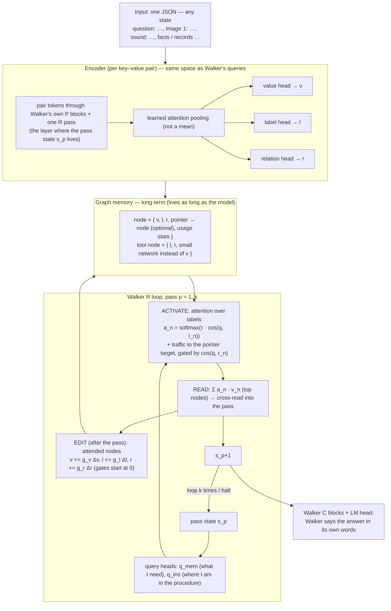

# Graph Node Memory module (GNM) — design v2 (authoritative)

Agreed with the user 2026-10-13. **This file is the only current description.** Earlier mechanics,
runs and bugs are in `docs/GNM_history.md` (superseded where they differ from this file).
Naming: **GNM** = this memory module. **Walker** = only the 1B LM.

---

## 1. Design



### 1.1 What a node has

| field | kind | meaning |
|---|---|---|
| **v** value | vector (D) | the information |
| **l** label | vector (D) | **learned**: what this is, how / when to use it. The only thing queries match. |
| **r** relation | vector (D) | learned: whether to pass activation along the pointer, for this query |
| pointer | node index (optional) | the node this one refers to (set at ingestion: JSON nesting / references) |
| usage stats | scalars | use count, keep strength (capacity, forgetting) |

Tool node: l, r + a small network instead of v. All of v, l, r are produced by the encoder and are
**editable** by the model afterwards.

### 1.2 How it queries (each recurrent pass)
1. Walker's pass state `s_p` → `q_mem`, `q_ins`.
2. Pick by label: `a_n = softmax(τ · cos(q, l_n))` (learned τ); `q_ins` over instruction nodes, NEXT
   pointers carry the procedure forward.
3. Traffic: an active node passes activation to its pointer target, scaled by `σ(cos(q, r_n))`.
4. Read: top nodes' values, weighted, cross-read into the pass (Walker sees vectors, not tokens).
5. Edit: attended nodes' v, l, r get gated deltas from `s_p`.
6. k passes (or halt); Walker's own head speaks the answer.

### 1.2.1 The relation vector is an **edge feature**, not friction (v2.1, `NodeMemV2`)
`r_n` must not be a redundant query gate. Besides `σ(τ_r·cos(q, r_n))` on the nesting edges, the module
adds **two learned, directed adjacencies** (both strict no-ops at init; opened only by training):

**(a) relation-similarity edges** — "r_i and r_j together say how i and j relate" (ownership, inverse /
"opposite", neighbour), connecting nodes the fixed nesting edges never link:

    A_ij = (ea(r_i) · eb(r_j)) / √D        reladj = softmax_j A_ij

**(b) conditional dependence edges** — the target of a node is a **conditional function of its owner and
its relation** (TransE-style), so change the owner and the target moves with it:

    pred_k = V[owner(k)] + rop(r_k)        opadj = softmax_j ⟨pred_k, V[j]⟩

Activation then flows along both: `s_j += w_edge·Σ_i c_i·reladj_ij + w_op·Σ_i c_i·opadj_ij`. The
dependence edges give the walk along value edges a learned conditional map (owner + r → the entity it
refers to) instead of the rule-made pointer — the missing "edge for the hop" (history §1). All of
`ea/eb/w_edge`, `rop/tau_o/w_op` are ordinary `NodeMemV2` parameters. They are **bitwise no-ops at init**
(`w_edge = w_op = 0`), so existing runs/checkpoints are unchanged; gradients flow from the node CE (a
mass-sum objective is invariant and gives them none — use a node-selective loss). The same is mirrored in
the non-v2 `NodeMemory`. `gnm_lm` passes `V` into `activate_batch` so the operator can see the value space.

### 1.3 Vector types per module
| module | vectors |
|---|---|
| encoder | per pair: token states → 3 outputs (v, l, r) |
| node | 3 (v, l, r) + pointer index + scalars |
| tool node | 2 (l, r) + network |
| Walker per pass | state s_p (2048), 2 queries (D), read (D → 2048), 3 edit deltas |

### 1.4 JSON
Any JSON: each `key: value` pair is a node; a nested object is a record node whose pairs point to it;
array elements are nodes pointing to the parent (index in the key); references become pointers;
numbers / booleans / text are encoded as the pair's text. Image / sound values need their own
encoder projected into the same space (not built). The question is itself a pair in the input JSON
(it lives in memory; Walker is not given it directly).

### 1.5 Rules (user)
- Matching is by **learned label vectors** (cosine attention). No hand rules such as word overlap.
- The question lives in memory; Walker is not handed the question.
- Walker turns what it reads into fluent language and pieces ideas together (no copy pointer).
- k = recurrent passes per question; N = parallel rollouts of one question, learn from the best (RL-like).
- KISS; combined runs, not sweeps; uploads only via `molab_upload/`; never connect MoLab to the local
  computer.

## 2. Known vulnerabilities (to handle while building)
1. **Encoder–query space mismatch** (root cause of the old failures): labels came from final-layer
   mean-pooled states, queries from mid-layer pass states. v2 encodes with the same Walker blocks.
2. **Stale vectors** in long-term memory as heads train → store token states; recompute v/l/r with
   the current heads (idle refresh).
3. **Cold start under answer-only** (old B1 = 0) → aligned space, N rollouts, per-pass targets where
   the data has them.
4. **Crowding** (many near-identical labels) → learned τ, candidate stage, pointer traffic; an ANN
   index for very large memories.
5. **Edits that corrupt** long-term memory → bounded gated deltas, only attended nodes, keep the
   original encoding to restore, usage stats; cross-episode effects of an edit are not trainable by
   backprop.
6. **Pointers from free text** need resolution; design-consistent: the model's `link` tool by value
   cosine (exact-name rules are a stopgap).
7. **Walker must learn to read vectors** (frozen; gate starts at 0) → train the read path, maybe a small
   adapter; keep the no-harm KL check.
8. **When to stop** → soft halting over passes or Walker's halt rule.
9. **Operations** (compare / count / sum) → tool nodes in the pairing.
10. **Cost** → encode once, store states; do not re-encode the whole memory every step.

## 3. Build order (each step tested answer-only, no word overlap)
1. **Aligned encoder over the whole JSON document** (P + one R pass, span attention pooling, v / l / r
   heads) + cosine label attention + relation-gated pointer traffic. ← **built** (`gnm_v2.py`, `gnm_lm_1b.py --v2`, tests 48). The query
   heads start as the label head applied to the pass state (`tie_queries`), so q and l share a space at
   step 0. Runs (synthetic procedures task, question in memory, no word overlap): **V1** = per-pass
   targets (can v2 labels learn at all?), **V2** = answer-only (the real test).
   Step 450: V1 per-pass loss 7.25 → 7.10 (barely moving), fact found 0.0 after the question, held-out
   .04; V2 same (.04). Question found 1.0 in both. If V1 is still flat at 1000: stop, probe the label
   space untrained (does a question naming X rank X's label first by cosine? what does pooling see —
   it starts as a mean).
   **Probe (user: "is gradient even flowing?")** — gradient reached the heads, but two bugs in my v2:
   (1) labels of different nodes had cosine .970 (Walker's shared direction; the per-feature
   standardization of the old encoder was missing); (2) cosine scores are all positive (~+9.7), so
   pointer traffic summed children into parents (+24 per record) and swamped even the question search
   (question found 0.0, so the per-pass loss was cut after pass 1 and the value head got 0 gradient).
   Fixes: running per-feature standardization of token states; traffic passes only above-average
   (centered) activation. After: label cosine between nodes .017, question found 1.0, value-head
   gradient 21. V1 / V2 relaunched (old logs `V*_1b_v0.log`).
   **Step-by-step trace (user: "log every step, find the bug").** With per-pass targets, pass 1 finds
   the question (rank 1) but from pass 2 activation is ~uniform (max .006) and the asked person's record
   ranks ~230 of ~350. Found: (a) the query could not carry what was just read into label space → added
   `qr` / `qi` (next query from the read nodes' pooled states, starting as the label head); (b) traffic
   clamp gave below-average nodes zero gradient → softplus; (c) **root cause: each node was encoded
   alone**, so "neighbor: Oscar Clarke" carries no trace of whose fact it is. My first fix (prefixing
   "Paul Thompson / …" to the encoder text) was a hand-made shortcut — reverted (user). **Design fix:
   the graph is serialized as ONE JSON document** (facts nested in their record's object, steps in their
   procedure, questions as pairs), Walker reads the whole document once (P + one R pass), and every node
   is the token span of its pair: context reaches each node only through Walker's own attention; what
   the label encodes is learned. Tests 51 (document is valid nested JSON; the same fact under two owners
   gets different vectors). All box jobs stopped; awaiting upload.
   **Trace with the document encoder (300 steps, per-pass targets):** question found 1.0; the instruction
   finds the named procedure's steps in order (~1.0, e.g. "step 1: boss" .99 → "step 2: neighbor" 1.00
   → "step 3: boss" 1.00); the top facts have the **right relation**; gold rank p2 / p3 / p4 ~100 → 26 / 8
   / 3 (of ~400); per-pass loss 9.3 → 3.8. Missing: **which person** — owner record rank ~170–230,
   activation diffuse (max .03–.15). Cause found: traffic summed children into parents with a small
   negative offset per child, so big records were pushed down. Fix 4: a parent gets the **mean** of its
   children (tests 52, exact check). Value-edge pointer following was already active for passes 3+
   (I had wrongly said it was off). Fix 4 committed locally; box apply pending (page disconnected).
   Fix 4 applied on the box; trace to 270: gold fact rank p2 / p3 / p4 22 / 7 / 7, owner-record rank
   still ~210 — but records are never per-pass targets, so their rank is not the right measure; with the
   document encoder a fact's own label can carry its owner. Slow but steady.
   **User corrections (2026-10-13):** (1) more **recurrent passes** k (not training steps): `--extra E`
   gives k = steps + E (+1 for the question); after the last step the per-pass target holds the final
   fact; `--halt` = soft halting so extra passes are used only if they help. (2) **No fixed read count**:
   the model receives every node in proportion to its activation (K = all in `--soft`); which pointed
   nodes come along is the relation-gated traffic. (3) **Edits will be optional per node** (a learned gate
   per attended node, starting at 0) — not forced on every node read; not built yet. Tests 53.
   Box fully reset (new notebook `nb_3vbXNgNScAnen51S3qTPZA`): 11 files re-uploaded and verified,
   checkpoint re-downloaded from HF (read-only), tests 53 pass in 8 s (the earlier 6-minute hang was the
   old state). **V1 (per-pass targets) + V2 (answer-only) launched**: document encoder, question in
   memory, no word overlap, `--extra 2 --halt`, read every node, 3000 steps, eval every 250.
   Runs renamed: **R-chain** (V1, per-pass targets), **R-answer** (V2, answer-only), **R-example** (RX,
   `--proc-layout example`: no procedure nodes, one worked example per procedure on another person —
   the model must reuse what it read as a procedure; user: procedure-given is not realistic).
   At ~1500 steps: R-chain held-out .07 (facts .10 / .15 / .15), R-answer .04, R-example .01.
   **Code re-read (user: "maybe a stupid bug") found it:** with the question in memory, **100% of pass-2
   activation went to question nodes** (measured on the tiny model, all samples): the query made from
   the question read starts as the question's own label, so it re-finds questions (own + the other 15
   alike). Also: `cq_mem`/`cq_ins` were tied to the label head on Walker's " Answer:" state — one
   constant vector added to every query — and their read columns were random noise. Fixes: questions
   leave the content search after the search pass (like instruction nodes, found by their own channel);
   the node just read is not re-read next pass (log(1 − a_prev)); `cq_mem`/`cq_ins` start at 0 when the
   question is in memory. Tests 55. All three runs restarted (old logs `*_prefix.log`).
   **Underfit or missing information? (`gnm_diag.py`, user question)**
   - Probe on frozen states (untrained pooling): fact → owner by raw cosine .07 (chance .025); a trained
     bilinear map, 30 worlds → 10 new worlds: owner **.65** held-out (train 1.00); relation **1.00**.
     The owner is in Walker's states, but needs a learned mapping and is only partly linear.
   - Overfit one fixed world (same 16 questions, per-pass targets): answer **1.00**, facts 1.00 every
     pass, instruction 1.00 by step 50 — gradients flow, capacity is enough, no plumbing bug left.
   - So the failure is **generalization** of the query → owner mapping across new worlds (runs at 500
     steps: held-out .01–.03).
   R-answer and R-example stopped (they need R-chain to work first). **L1** = R-chain alone, 10,000
   steps, 4 worlds per step (`--worlds`, gradients accumulated), lr 3e-3 (gate ×10), eval every 500.
   If held-out stays low while training fits: the frozen states' owner signal is the limit (probe
   ceiling .65) → LoRA adapter on Walker's early blocks for the encoding.
2. Edits after each pass.
3. Walker says the answer (copy removed).
4. Generic JSON ingester in the pairing, then real data (RoG-CWQ is downloaded; 2WikiMultihopQA is too
   sparse: ~1 fact per entity).

## 4. Status of earlier results (details in GNM_history.md)
| result | what it actually shows |
|---|---|
| GNM alone: lookup .91, edit 1.00, recall .90 | retrieval was carried by IDF word overlap (gold rank by label alone 75–244) |
| Walker 1B pairing A1 1.00 / B2 .83 | label match works **with per-pass gold targets and forced candidates** |
| Answer-only D2 / E1 1.00 | word overlap did the entity / procedure finding |
| Answer-only without word overlap (B1 .02, E2 .04, E3 .00 at 3000 steps) | ~0 — the honest baseline for v2 (E2/E3: question found 1.0 / 0.0, entity and procedure never found) |
| No-harm | plain-prompt KL .001–.003 with a graph attached |

## 5. Scripts (current)
| file | role |
|---|---|
| `gmem_node.py` | memory module (graph, activation, tools, memory ops, ingest, `WalkerTextEnc`) |
| `gnm_lm.py` | the hook in Walker's R loop (`GNMHook`, `attach`, `forward`, `graph_ctx`) |
| `gnm_lm_1b.py` | 1B pairing runs (synthetic procedures task, `--qmem`, `--link`, `--soft`, `--n`) |
| `gnm_cwq_1b.py` | RoG-CWQ runs (question in memory, answer-only, soft halting) |
| `gnm_real_1b.py` | 2WikiMultihopQA runs (too sparse; kept for reference) |
| `gnm_lora.py` | LoRA adapter for the frozen Walker encoder (local / small-box runs) |
| `test_gmem_node.py`, `test_gnm_lm.py` | tests |

### 5.1 Local training with LoRA (`gnm_lm_1b.py --local --v2 --lora R`)
Full fine-tuning of the 1B needs the whole checkpoint + optimizer state; on a laptop you adapt only
the **encoder**: `gnm_lora.attach_lora` wraps the early blocks `[0, r_end)` (attn.qkv/proj + mlp) with
low-rank factors (B zero-init => exact no-op), freezes everything else, and `WalkerStateEnc` then runs
with grad on and no cache. The optimizer trains the LoRA adapter + the GNM heads only. Build a small
GPT-2-vocab Walker locally (no checkpoint) with `--local --D 192 --L 6`:

    python gnm_lm_1b.py --local --v2 --lora 16 --qmem --label-only --link --soft --halt --extra 2 \
        --sup chain --D 192 --L 6 --heads 6 --steps 300 --save runs/local_L1.pt --lr 3e-3 --gate-lr-mult 10

Caveat: a local `--local` Walker is **randomly initialized**, so its token states carry no name/owner
meaning — the run reproduces the L1 wall (only the question is found; the hops stay at chance) but will
not learn, exactly because the reps matter (`GNM off` = 0.00). LoRA on the **pretrained 1B** is the run
that can learn; use `--local` only to debug plumbing. Operator cost: the relation/dependence adjacency
is built ONCE per world in `graph_ctx` and reused by every R pass (`NodeMemV2.message_adj`), instead of
rebuilding the (N,N) tensor each pass.

## 6. GPT-2 vs 1B — where the difference is (2026-10-15, probes)

Question: the same recipe learns on the local GPT-2 harness but not on the 1B. Two probes separate the
candidates — the **substrate** (are the graph facts in the frozen LM's states?) and the **answer
channel** (does the answer loss reach the read?).

**Substrate** — `gnm_diag.py --probe-only` (owner = a fact picks its record via a trained bilinear on the
frozen pooled states; relation = 5-way linear; both held out to new worlds and names):

| metric | GPT-2 (d=768) | Walker 1B (d=2048) |
|---|---|---|
| owner, raw cosine, no training | .263 | **.323** |
| mean pairwise cosine of pooled node states | .202 | **.141** |
| owner held-out | .535 | **.648** |
| relation held-out | 1.000 | **1.000** |

The 1B's frozen states carry the graph **as well or better** → **the representations are not the wall**
(the per-feature standardization took the node-state cosine .97 → .14). The ~.65 owner ceiling is a
generalization limit, not a GPT-2 advantage (GPT-2 is lower).

**Answer channel** — `gnm_answer_probe.py` (no copy; the read is injected at a fixed scale; backprop the
answer CE to the raw read):

| arm | GPT-2 lm / dLM / grad_rms | 1B lm / dLM / grad_rms |
|---|---|---|
| closed | 8.33 / – / – | 11.79 / – / – |
| open 1.0 | 17.40 / **+9.07** / **8.1e-4** | 14.60 / **+2.82** / **3.0e-4** |

The read reaches both losses (nonzero), but the 1B's is **~3× weaker** (dLM +2.8 vs +9.1; per-element
grad 3.0e-4 vs 8.1e-4): the frozen C blocks + head absorb the read less.

**Conclusion.** The wall is the **answer→memory coupling**, not the substrate. A ~3× weaker coupling is
enough that **answer-only cannot hold a chain that only the lexical rule seeded** (`ins` drifts 0.94 → 0
under `--lm-only`), while GPT-2's stronger coupling can. Consistent with the log: the 1B only "spoke" the
answer with a stronger output path (copy, runs 8–10) and with deep supervision.

**Constraint (user, restated 2026-10-15):** the model **does** see the **final answer** at the end
(answer supervision is allowed); it does **not** see **how to link / traverse**. So the forbidden thing
is the **traversal** supervision, not the answer: no per-pass gold nodes, no forced candidates
(`force_mem`), no copy-as-target. `--sup chain` **is** that deep supervision (it sets `force_mem`) and is
**not allowed** — even `--lm-only --sup chain` still forces gold. The realistic arm is **`--sup answer`**
(answer-only), optionally with **`--selfsup`** (a self-supervised containment that still only uses the
final answer) + **`--link`** features + rollout exploration (`--n`/`--explore`). Design rule 1.5 keeps
"no copy pointer" as the target (build order step 3). Realistic levers to strengthen the answer→read path:
C-block LoRA (`--lora-scope late`), the RMS-matched bounded read, the standardized encoder — not
traversal supervision.

## 7. Model-built graph (perception → memory) — designed 2026-10-15

Today we hand the model a finished graph (`make_world` + rule `ingest`). This section makes the **model
build the graph itself** from what it reads. Everything downstream is **unchanged**.

**Input.** One document of **natural language** — the facts, the **question**, and any extra info, as
plain sentences (paraphrased, no JSON, no rule templates). Nothing is pre-parsed.

**Perception (the new part).** The model reads the document through its own P blocks + one R pass (the
same path the encoder already uses) and, from the token states, predicts the **node structure**:
- **node spans** — which token span is one node (a boundary / start score per token),
- the **key / value split** inside a span,
- a **parent pointer** per node — which earlier node it attaches to (the entity / record it refers to),
  as an attention over the node states.
The node vectors **v / l / r** are then pooled from the span by the **existing** heads (`NodeMemV2`);
what the label encodes is still learned — only the span is now *chosen by the model* instead of cut by a
rule. **Tool nodes unchanged.** The question and the extra info are read the same way and become nodes in
the **same** memory (the question is a memory node, per rule 1.5).

**Retrieval (unchanged).** `GNMHook` exactly as designed: `c_mem` / `c_ins` query vectors →
`softmax(τ·cos(q,l))` label match → relation-gated read → cross-read into the R pass → Walker's own head
says the answer. Same code at training **and** inference.

**Self-supervision (NO structure target — user refinement 2026-10-15).** We do **not** supervise the
graph's structure, and **not** reconstruction-into-a-fixed-structure (that would dictate the nodes). The
model **figures out its own node features and its own edits** each iteration. The only signals are:
1. **Query-consistency (the task):** the question node drives the normal retrieval; the answer is
   *contained in the document the model just read*, so the answer loss supervises graph → retrieve →
   answer. No outside labels — the text is the supervision.
2. **Soft, label-free signals:** the existing containment / entropy self-sup, and at most a weak **soft**
   boundary nudge — never a target graph.
The graph is **discovered, not dictated**.

**Flow per step.** `text → perception (build / refresh the graph: the model's own nodes + edits) →
retrieval (query vectors, label match, read) → answer`, with `L = L_answer + L_selfsup`. Forbidden stays
forbidden: no gold nodes, no forced candidates, no traversal supervision; the model only ever sees the
text and the final answer.

**Mechanical decision (A vs B) — chosen.** Train with **soft** spans (a differentiable per-token
assignment pooled by the existing attention) and read out **hard** (argmax) at inference: training stays
differentiable, the stored graph is discrete. Realistic engineering = *soft to learn, hard to store*.
Build order: **validate on GPT-2 first** (`gnm_trace.py --hf gpt2`, overfit one small real document:
can the model discover usable nodes + edges from text alone?), then port to the 1B on small real data.

**Corrections (user, 2026-10-15) — the prototype violated these; the build must obey them.**
1. **One big graph, persistent — never rebuilt.** A single world exists for the model's whole life. New
   input does not build a fresh graph; it attaches to a **subworld** — the **connected component** of the
   big graph the input touches (usually a small component). The reader outputs **EDITS** (add node/edge,
   update value, merge duplicates, forget) against the one store; nodes carry usage stats and versions.
   (Earlier wording that the graph is rebuilt per world was wrong.)
2. **The graph itself must emit a signal.** Building correctly long-term needs a **contradiction /
   consistency signal from the graph**: when new text conflicts with a stored node (same key, different
   value) or a retrieved chain contradicts the store, self-sup pressure must resolve it (version + history,
   merge) and penalize silent contradiction/duplication. This signal comes from the data vs. the store —
   no gold.
3. **Question (+extra) ingestion is the model's choice.** Per the design, for each question the model
   processes it and **may** store it as another node (a write gate decides whether/how) — never forced.
4. **More cases per graph = more fixing.** Each new case (question + new facts) is edit pressure: add
   what's missing, correct what's wrong, merge what's duplicated — with stability gating so the graph
   doesn't churn, and held-out queries as the measure that the fixing generalizes.
5. **Every action is a model-decided knob — never forced.** Each operation (write / add / update / edit /
   halt / read) is applied through a **gate computed from the model's own state**; the code must not force
   one. A candidate node is written only if the *write* gate says so; a row is updated only if the *update*
   gate says so; the loop halts only if the *halt* gate says so. Soft to learn, discrete at inference.

**Status (2026-10-15).** `gnm_reader.py` = `GraphReader` ONLY (perception: hard spans for storage, soft
slots for training, v/l/r from the existing `NodeMemV2` heads, parent pointer). The **compliant** runner
is `gnm_reader_gnm.py`: the reader's discovered nodes go through the **documented** pipeline —
`NodeMemV2.message_adj` relation/dependence edges → `gnm_lm.GNMHook` (c_mem/c_ins, `softmax(τ·cos(q,l))`,
relation traffic, cross-read) → the R loop → **Walker's own head**. GPT-2: loss → 0.000, all four
questions correct (1- and 2-hop). `gnm_reader_smoke.py` validates the plumbing.

**Correction (2026-10-15, compliance).** Three earlier ad-hoc scripts (`gnm_reader_train.py`,
`gnm_store_train.py`, `gnm_loop_train.py`) substituted custom retrieval (plain label match, no relation
edges / instruction channel) and a custom answer head for the documented ones. They were **deleted**;
`GraphStore`'s custom `read` was removed. The rule, now enforced: **the reader changes only the graph
SOURCE — it never re-implements retrieval or the answer.** Local lab log: `docs/GNM_LOCAL_LAB.md`.

**Next.** The persistent store (§7 correction #1) must be built **on top of** `GNMHook` — its rows are the
node arrays `graph_ctx` feeds the hook — with model-choice question writes and a contradiction signal
from the store-vs-new-text (no custom read).

## 8. Primitive-design checklist (status 2026-10-15, after the autonomous loop IT-1…IT-16)

Legend: ✅ built+tested · 🟡 partial · ❌ not built.

| § | primitive | status | where / note |
|---|---|---|---|
| 1.1 | value `v` / label `l` / relation `r` (D each) | ✅ | `NodeMemV2.hv/hl/hr`, `NodeStore` |
| 1.1 | pointer → node | 🟡 | store `ptr`; **question→fact pointer implemented**; reader does not predict arbitrary pointers |
| 1.1 | usage stats + keep-strength | ✅ | `NodeStore`: `usage`, `keep` (decay + eviction) |
| 1.1 | tool node = {l, r, network instead of v} | 🟡 | `NodeStore.toolnet` + `effective_V`; structure, **not exercised** |
| 1.1 | nodes **editable** (model writes v/l/r) | ✅ | EDIT deltas (`edit_v/l/r` + gates) + **per-pass EDIT** |
| 1 | encoder: P blocks + one R pass, learned pooling, v/l/r heads | ✅ | `WalkerStateEnc`, `NodeMemV2.pool` |
| 1 | graph lives for the model's whole life (one big world + subworld components) | 🟡 | `NodeStore` persists across steps; **subworld ❌**; the 1B pairing still rebuilds per world |
| 1.2 | pass state `s_p` | ✅ | the R loop |
| 1.2 | query heads `q_mem` / `q_ins` | ✅ | `GNMHook.cq_mem/cq_ins` |
| 1.2 | ACTIVATE `softmax(τ·cos(q,l))` | ✅ | `NodeMemV2.score` |
| 1.2 | traffic gated by `σ(cos(q,r))` | ✅ | `gate` + `activate_batch` |
| 1.2.1 | relation-similarity edges (`ea/eb/w_edge`) | ✅ | `NodeMemV2`; **`w_edge` now nonzero** (verified) |
| 1.2.1 | conditional dependence edges (`rop/tau_o/w_op`) | ✅ | `NodeMemV2`; **`w_op` now nonzero** (verified) |
| 1.2 | READ: top-K values → cross-read into the pass | ✅ | `GNMHook._read` |
| 1.2 | **EDIT after the pass** (gated deltas to v/l/r) | ✅ | per-pass EDIT (runner wraps `hook._read`) |
| 1.2 | NEXT pointers carry the procedure (instruction channel) | ✅ | `nxt` + `ins` nodes |
| 1.2 | halt | 🟡 | soft mix (`--halt`), not a discrete model knob |
| 1.2 | `s_p` → C blocks + LM head (Walker says it) | ✅ | the pairing / Walker's answer |
| 1.5 | matching by learned labels | ✅ | — |
| 1.5 | question in memory | 🟡 | the store writes question nodes via the reader; no explicit "may I write" gate |
| 1.5 | k passes / N rollouts | ✅ | `--extra`, `--n` |
| 1.5 | no copy pointer | 🟡 | copy is a crutch; not used in the compliant store path |
| 7 | reader: text → nodes | ✅ | `gnm_reader.GraphReader` |
| 7 | compliant wiring reader → `message_adj` → `GNMHook` → Walker | ✅ | `gnm_reader_gnm.py` (GPT-2) |
| 7 | persistent store, write-only, on the hook | 🟡 | `gnm_store.py` + `gnm_store_gnm.py`: exclusive rows, `contra ~0`; **the READ is weak** |
| 7 | **every action = a model-decided knob** | 🟡 | softmax/sparsemax/settle/exclusive; some ops still unconditional |
| 7 | model-choice question/extra writes | 🟡 | questions written by the reader; no explicit gate |
| 7 | contradiction resolution (version + merge) | 🟡 | `version` ✅; **MERGE/dedupe buggy** (over-kills → off by default) |
| 7 | capacity / forgetting (merge · evict by keep) | 🟡 | evict by `keep` ✅; no merge-to-reduce |
| 7 | discrete add/update (sparsity on the write addressing) | 🟡 | exclusive assignment (discrete-ish); dedupe buggy |

**Current accuracy (M1 test):** stage A (4 questions) **1/4**; stage B (2 questions) **~1/2**, best-ever `[1,1]` (IT-11).

**Live blocker:** the **READ does not traverse** question→fact — the content query stays on the question node — capping accuracy. `w_edge/w_op` and the question→fact pointer exist and are nonzero, but too weak to move `c_mem`.

**Still missing (ranked):**
1. **READ traversal** question→fact (the blocker).
2. **MERGE / dedupe** (implemented but over-kills → off by default).
3. **Subworld** (one big world + connected components).
4. **Discrete model-decided halt**.
5. **Tool nodes** exercised in the pipeline.
6. **Model-choice ingestion gate** (question / extra / arbitrary JSON).
7. Step C real data; G1 do-no-harm on the official mix; the 1B port; LOTUS CoT supervision (deferred).

## 9. Fast-weight memory (FWM): memory as a writable network (2026-10-18, user idea)

**Idea (user).** A network can already be trained to memorize; so memory can be a separate network that
does a small computation, *query → transformation*, instead of a graph that must be *searched*.

**Why it targets the wall.** Every graph attempt stalled on **addressing**: learning which of N nodes to
pick (slot collapse IT-4…7, the read that does not traverse IT-36…38). A fast-weight memory replaces the
search by one product: write `M += g·β (v − M k̂) k̂ᵀ` (delta rule; Schlag et al. 2021, *Linear Transformers
Are Secretly Fast Weight Programmers*; Titans, Behrouz et al. 2025, is the test-time-learned relative),
read `v̂ = M q̂`. Cost per read is D², independent of how many facts are stored. The smart encoder is
reused unchanged.

**Design (`gnm_fwm.py`).**
- write: facts as one document → frozen encoder (P blocks + one R pass, per-feature standardized) → per
  fact: learned attention pools → key `k`, value `v`; a model-decided write gate `g` (starts open, never
  forced); keys centred per world.
- read = the recurrence: the question is encoded **alone** (no facts in its context → no in-context
  shortcut). hop 1: `q = Wk(pool(question))` (same key head and pool as the facts: one space);
  hop t: `q = Wn([question, r_{t−1}]) + e_t`; soft halt over hops.
- answer: the halted read is injected late into Walker (RMS-matched, tanh gate) at the answer position;
  **Walker's own head** says the name. Walker runs once.
- **Recurrence merged (RECURRENT/OPR lesson):** OPR showed recurrence inside the big network does not
  pay for its compute (plain depth matches it at half the cost). Here the iteration lives in the memory
  loop (k cheap D×D hops) and Walker runs once.
- training: final-answer CE + optional **masked recall** (`--cloze`: any stored sentence minus its last
  word must recall that word — generic, self-supervised, no traversal supervision).
- tests: held-out worlds every eval (8 worlds, 10 of 30 names never trained), ablations *memory off* and
  *another world's memory* (catches shortcuts), diagnostic: does each hop's read land on the gold fact
  (measured, never trained).

**Findings (GPT-2 local lab, 12 people × 3 relations = 36 facts per world).**
| step | finding |
|---|---|
| untrained memory | keys near-orthogonal (cos −.005), **self-recall 1.00**: storage works at init |
| f1–f5 (answer-only, + tying, + centering, + masked recall, + token stream) | held-out 1-hop .10–.17, other-world .03 — weak; f3 closed the write gate (.05) |
| oracle key (diagnostic) | read with the stored key → says the right name **1.00 by step 100** on new worlds: **decoding works; the wall is addressing** |
| layer sweep | question → its fact with *document* stats: chance at every layer |
| **bug found** | queries (encoded alone) were standardized with the **document's** statistics → one shared offset in every query → every query picked the same fact. With their **own** running stats, the *untrained* contextual states match a masked query to its fact **.889** (random key head + centering .72) |
| **f6** (fixed, + masked recall, 2000 steps) | held-out **1-hop .39** (other-world .06, off .00), masked recall .75, 2-hop .09–.15 |

**Lesson (applies to the graph too):** every stream that is encoded in a different context (questions
alone vs facts in a document) needs its **own** standardization statistics. The GNM graph runs encoded
questions inside the document (not affected); the store/reader lab should be checked.

| **f7** (= f6, 6000 steps) | held-out 1-hop .34→.45 (plateau from step 4000), 2-hop .08→.17; other-world .03–.08, off .00. Same checkpoint on worlds of *trained* names only: 1-hop .56, 2-hop .22 (training-batch mean at the end .64/.20) → mostly **underfit**, unseen names cost ~.1 |
| **f7 diagnosis** (`gnm_fwm_addr.py`, held-out worlds) | the trained key head **finds the right fact .79** (question → key, top-1 of 36; masked text .77) and values encode the target name (cos same-target .80 vs other .21), **but the linear read returns the right name only .50 — even read with the exact stored key (self-recall .50)**. The write gate drifted to .33; a partial delta-rule write leaves the crosstalk of the other 35 keys (~1/√dk each) larger than the signal. A softmax read over the same trained keys/values: **.79** |

**Fix (f8): the memory network gets a nonlinear hidden layer.** The same memory, read as a 2-layer
network written in one shot: one hidden unit per fact (W1 = keys, W2 = values), softmax activation with a
learned sharpness, the write gate = the unit's log gain (still the model's choice). `r = softmax(τ q̂Kᵀ +
log g) V`. Linear (delta rule) stays as `--act linear`. Cost O(N·dk) per hop instead of dk², still no
learned search over N nodes: the key head that already works does the addressing.

| **f8** (softmax memory net + masked recall, 2000 steps) | held-out **1-hop .73** (f6 at the same steps: .39), other-world .03, off .00; training 1-hop and masked recall 1.00, write gate .87 (open). **2-hop .12**: the soft halt collapsed onto hop 1 (π = [1, 0, 0]) by step 500, so hops 2–3 never got a gradient |

**Fix (f9): every hop is a rollout** (the user's "N rollouts" idea, with the hop count as the rollout).
Walker answers from each hop's read (a 2-token forward, batched); loss = soft-min over hops (weights
`softmax(−CE)` detached: the best rollout counts most; final answer only, no hop is named); the halt is
trained to predict those weights; inference takes the halt's argmax hop and runs Walker once. `--halt mix`
keeps the old soft mixture.

| **f9** (= f8 + every hop a rollout) | halt no longer collapses (π ≈ uniform), held-out 1-hop .72, **2-hop still .12**; hop 2 never lands on the second fact (.00–.08): hops 2–3 repeat hop 1 |

**Composition wall.** Hop 2 must turn the value of fact 1 (B as the *answer*, "A's boss is B") into the key
of fact 2 (B as the *subject*, "B's friend is C"). In contextual states those two Bs look different; only
the token identity is shared. f10 = f9 + the token-embedding stream into the key/value heads (`--tok-emb`:
both sides get the same identity coordinates, `Wn` only has to learn a linear map).

| **f10** (= f9 + `--tok-emb`) | 1-hop .70, 2-hop .19 (other-world .09), hop 2 still never lands (.01) |
| **hop-2 probe** (`gnm_fwm_hop2probe.py`, diagnostic: a fresh hop-2 map fit **with** the gold second fact on frozen f10) | given the gold fact-1 value, a linear map lands on fact 2 **.96** on held-out worlds → **composition is representable**. But on 2-hop questions **hop 1 lands on fact 1 only .03** |

**Diagnosis: credit assignment, not representation.** Hop 1 is rewarded only when hop 2 also works, and
hop 2 learns only from a correct hop 1; meanwhile the soft-min asks hop 1 to say the final answer directly
(impossible for 2-hop) → noise. The classic fix (End-to-End Memory Networks, bAbI 2-hop, answer-only):
start with a soft read so the gradient reaches every fact, then let it sharpen. τ is already learned;
f11 = f10 + `--tau0 1` (start soft).

| **f11** (= f10 + `--tau0 1`) | **negative**: τ only crawled 1.0 → 1.6 in 2000 steps; reads stay blurry, 1-hop .11, 2-hop .07. Default stays τ0 = 10 |
| **prefix probe** (frozen f8 / f10, held-out) | hop 1 on 2-hop questions, query from the **whole** question → fact 1 **.03–.04**; from only the prefix "Who is A's boss" (causal encoder: identical states to the 1-hop question) → **.98–.99** |

**Diagnosis, final:** both pieces already work (hop 1 from the right part of the question .98, hop 2 from
fact 1's value .96). What breaks 2-hop is that **one pool views the whole question for every hop**.
**Fix (f12): per-hop focus on the question** — each hop re-attends over the question tokens with a scorer
conditioned on [hop, last read] (`Wc`, zero-init so every hop starts as the shared pool; learned, no hand
cut; MAC / memory-network controller style). f12 = f10 + per-hop focus.

| **f12** (per-hop focus, unnormalized `Wc`) | **broke**: Adam grew `Wc` coherently, focus scores exploded, every hop saw one random token; 1-hop .12, write gate swinging .33↔.88 |
| **f13** (focus direction unit-normalized × learned scale from 0) | stable (1-hop .66–.71) but the focus scale stays ~0: no signal reaches it; 2-hop .12–.17 |
| **f14a** (1-hop only + masked recall, 1000 steps) | 1-hop .67, read lands on the right fact **.92** (mixed runs .33–.50). Prefix probe: hop 1 on the **full** 2-hop question → fact 1 **.98** |

**Diagnosis:** mixing 2-hop questions from step 0 is what corrupts hop 1: before hop 2 can work, the
soft-min asks hop 1 to say the final answer of a 2-hop question (impossible), which wrecks addressing for
both kinds. A model that first learned 1-hop already addresses fact 1 correctly from the full 2-hop
question. **Fix (f14): curriculum** (data order only, no extra supervision): 1-hop first (f14a), then
continue with 50% 2-hop.

| **f14** (f14a → + 50% 2-hop, 2000 steps) | **curriculum alone fails**: hop-1 landing .92 → .39 within 500 steps, 2-hop .14–.18 |

**Diagnosis, corrected:** the soft-min already gives hop 1's own (wrong) answer a tiny weight once hop 1
confidently says B. The corruption path is the **chain gradient**: hop 2's loss flows back through hop 1's
read, and a still-random hop 2 finds it easier to bend hop 1 than to learn its own map. **Fix (f15):
stop-gradient on the chain** (`--sg-chain`): each hop's query is trained only by its own rollout and takes
the previous read as given input; hop 1 stays a clean reader, hop 2 learns composition on top (the probe
showed that map is learnable, .96). f15 = f14a + `--sg-chain`.

| **f15** (f14a + `--sg-chain`) | **fails too**: 2-hop .11–.18. Prefix probe on f14/f15: hop 1 on the **full** 2-hop question → fact 1 **.02**, but on the prefix / 1-hop form still **.99** — hop 1 is broken *specifically* on 2-hop questions |
| hop-2 probe on f14a (hop 1 clean) | composition from the actual hop-1 read .47, from the gold value .52 (linear map; f10's values gave .96) |

**Diagnosis, final:** hop 1's **own** rollout loss on 2-hop questions. Until hop 2 works every rollout is
equally bad (soft-min weights ≈ uniform), so hop 1 gets a third of the pressure to say C directly and
learns to address something else on 2-hop questions. **f16: staged training** — phase 1 (f14a) learns to
read (keys, values, decoding: 1-hop + masked recall); phase 2 freezes the reader (`--train-only
Wn,Wc,c_scale,hop_e,Wh`) and learns only to chain, with an MLP next-query map (`--wn-mlp`; linear tops
out ~.5).

| **f16** (staged, reader frozen, focus + MLP chain trainable) | **fails**: 2-hop .13–.18; the trainable focus bent hop 1 again (landing .92 → .46), and hop 2 lands ~0 even while hop 1 was still clean |

**Hop 2's own problem = exploration:** a random next-query against 36 sharp keys (τ ≈ 11) puts ~0 weight on
the right fact → almost no gradient finds it. **f17:** phase 2 from f14a with reader **and** focus frozen
(hop 1 untouchable), hops ≥ 2 get their **own** softer sharpness (`--tau-hop0 3`, learned; the soft start
applied only where exploration is needed), MLP next-query map.

| **f17** (f14a → phase 2: reader + focus frozen, `--tau-hop0 3`, `--wn-mlp`, `--sg-chain`, 2000 steps) | **2-hop works.** Held-out (10 of 30 names unseen): **2-hop .47–.55** (other-world .06, off .00), hop 2 lands on the second fact .36–.40, hop 1 .89. Training 2-hop 1.00. New worlds with **trained names only: 1-hop .89, 2-hop .94** (halt-weighted mix .98 / .94). Hop-2 sharpness grew 3 → 5–6 by itself |
| f17 inference variants (held-out) | halt argmax .54/.53, halt-weighted mix of every hop's answer .58/.52, Walker's most confident hop .71/.11, best hop (upper bound) .73/.56 → the halt routes some held-out 1-hop questions to hop 2 |

### 9.1 Where FWM stands (2026-10-18)

**Recipe (two stages, answer-only, no gold path, no hop named):**
1. *Read* (f14a): `--two-hop 0 --cloze 36 --tok-emb`, 1000 steps. 1-hop questions + masked recall teach keys,
   values and decoding. Mixing 2-hop in from step 0 corrupts hop 1 (f9–f15).
2. *Chain* (f17): load stage 1, `--sg-chain --wn-mlp --tau-hop0 3 --train-only Wn,hop_e,Wh,tau_h`, 50% 2-hop.
   Hop 1 is frozen as a clean reader; hop 2 learns value → next key with a soft start; the halt learns
   which hop answers.

**What each piece fixed:** softmax memory net (f8: 1-hop .39 → .73); every hop a rollout (f9: no halt
collapse); staged training + frozen reader (f14–f17: hop 1 not dragged by 2-hop pressure); soft start for
hops ≥ 2 only (f17: hop 2 finds the second fact; f11 softening all hops failed).

**Open:**
- **Unseen names** are now the main gap (2-hop .94 trained names vs .53 held-out; 1-hop .89 vs .54). 30
  training names is a tiny entity set: the module and Walker's decoding never saw 10 of the names. Next:
  many more names (or arbitrary multi-token strings) in training.
- **Halt routing** on held-out 1-hop (.54 vs .73 best hop).
- The per-hop question focus (`Wc`, `c_scale`) is unused (frozen at scale 0 in f17); it stays only for the
  f12/f13 record.
- Staged training is a curriculum; a single-stage recipe is not found yet (all single-stage runs f9–f13
  stall at 2-hop .12–.19).
- Then: 3-hop, real data (RoG-CWQ, JSON PC-state), port to the 1B, do-no-harm on the official mix.

### 9.2 Eval policy changed (user, 2026-10-18): hold out VALUES, not names

"We are training a memorizer": the vocabulary is fixed and known; what must be new at test time is the
**assignment** (which value is stored), so the answer is predictable only from memory. No held-out names.
Names alone are thin context, so the default world is now **typed** (`--data typed`): people → person
(boss, friend), people → attribute (city, color, age), variables → numbers (`x's value is 42`); 68 facts per
world; 2-hop chains cross types ("What is A's boss's city?"). Eval = new worlds, same vocabulary
("new world"). `--data people` keeps the f1–f17 world.

| run (typed) | new world 1-hop | 2-hop | notes |
|---|---|---|---|
| **t1** stage 1 read (1-hop + masked recall, 1500 steps) | **1.00** | — | other-world .04, off .00 |
| t2 stage 2 chain | .93 | .50 | bug: τ-hop loaded as 10 from t1 (soft start lost) |
| **t2b** stage 2 chain (soft start fixed) | .94 | .57 | split: hop 1 on 2-hop questions **.53** (stage 1 never saw them: "A's boss's city" reads A's city); hop 2 given hop 1 right .76 |
| **t3** stage 3: hop-1 question focus learns **only through the chain** (`--detach-own1`: hop 1's own answer is detached; hop 2's loss flows back through hop 1's read) | .87 (mix .95) | **.87** | hop 1 on 2-hop questions .53 → **.96**, hop 2 given hop 1 .79; best-hop bound 1.00 / .98; the halt sends half the 1-hop questions to hop 2 |

Chain credit into hop 1 failed in f14 (hop 2 still random then); after stage 2 it is informative.

| t4 halt only, per-hop cost `--ponder 0.5` (prefer the earlier of two hops that both answer) | .90 (mix .96) | .79–.81 | π ≈ [.35, .51, .13]: barely moved |
| t5 halt only, halt also sees the question (hop 1's view) | .91 (mix .96) | .82 | same; upper bound 1.00 / .98 → the remaining gap is routing |

**Recipe (typed, answer-only, no gold path):** stage 1 read (`--two-hop 0`, t1) → stage 2 chain (`--sg-chain
--wn-mlp --tau-hop0 3 --train-only Wn,hop_e,Wh,tau_h`, t2b) → stage 3 hop-1 focus via the chain
(`--detach-own1 --train-only Wc,c_scale,hop_e,Wn,Wh,tau_h`, t3). New worlds (68 facts, new assignments):
**1-hop ~.9, 2-hop ~.85**, other-world .03, memory off .00. Eval noise ~±.03 (8 worlds).

**Open:** halt routing (~.05–.1 of the remaining loss); a single-stage recipe; 3-hop; more facts per
world (capacity); real data (JSON PC-state, RoG-CWQ); port to the 1B.

### 9.3 Design notes from the user (2026-10-18)

**Hybrid = GNM primitives + fast-weight framing + recurrence in the module.**
```
JSON doc ─► smart encoder (Walker P blocks + 1 R pass) ─► per pair: key l, value v, write gate g
question (encoded alone) ─► hop 1 query ─► softmax(τ·cos(q, keys) + log g) · values = r1
                            hop t query = f(question focus_t, r_{t-1}) ─► r_t        (t = 2..k)
                            halt ─► r* injected late into Walker ─► Walker says the answer (runs once)
```
Since 2026-10-18 the facts are written as ONE nested JSON document through the built encoder (`--doc json`,
`json_pieces`): a record per subject, one pair = one fact; the subject is only in the context. Image /
sound encoders are still not built (§1.4).

**Query = the model's.** Hop 1: the model's key head over the question states (learned pooling); hop t:
a learned map from the hop's view of the question and the previous read. No hand rule.

**Relation vector `r` = grouped / dependent updates (user).** Its purpose is not lookup: facts are linked
and depend on each other; when an ancestor is updated its descendants must follow, and `r` gives the
context-dependent relation. Not in FWM yet (each world is written fresh). Planned:
1. UPDATE: a new pair whose key matches a stored unit replaces its value (model gate; version + 1).
2. PROPAGATE: units linked by a relation gate `σ(cos(r_j, r_i))` are refreshed from the change.
3. Test: worlds with dependent facts ("Mark lives with Lucy" → Mark's city follows Lucy's); write, then an
   update document (`"Lucy": {"city": "Paris"}`), then ask a dependent ("What is Mark's city?").

**LOTUS-style CoT supervision of the latent hops (user wants it).** Each hop's read already goes through
Walker's head (rollouts), so CoT step t ("A's boss is **B**") supervises hop t: Walker must say the step
from that hop's latent; the halt's target is the CoT length. Inference stays latent (no CoT). The loop
lives in the memory module (Walker decodes, does not loop). This relaxes "no traversal supervision" to
*content* supervision from CoT text (never node indices); the answer-only recipe stays as the comparison.

**JSON write needs the record pointer (found 2026-10-18).** Writing facts as nested JSON, a pair
(`"city": "Miami"`) does not contain its subject; from the pair span alone 1-hop fell **1.00 → .14** (text
sentences: 1.00). Per design §1.4 a nested pair points to its record: the fact unit now pools over its pair
**and** its record's key → **1.00** again (`json_pieces` returns the parent piece; resolved at ingestion).

**Runs (2026-10-18, typed JSON, hops = 6, depths 1–5):** `fwm_j1/j2/j3` = the three-stage answer-only
recipe; `fwm_c1` = LOTUS-style `--cot` single stage from scratch (all parameters).

| run (typed JSON, hops = 6, depths 1–5) | new world accuracy by depth 1 / 2 / 3 / 4 / 5 | notes |
|---|---|---|
| j1→j2→j3 answer-only three-stage | stage 1 failed: depth 1 **.19** | answer-only soft-min over **6** hops on JSON is fragile (same JSON with 3 hops: 1.00; text with 6 hops: 1.00); stages 2–3 built on a broken reader, stopped |
| **c1 `--cot`** (LOTUS-style, single stage from scratch, all parameters, 4000 steps) | **1.00 / 1.00 / .98 / .98 / .92** (step 3500: .96 at depth 5) | other-world .00–.04; halt ≈ best-hop bound (routing solved: its target is the CoT length) |

| **c2 `--cot`** (depths 1–8, 9 hops, 6000 steps) | step 5000: **1.00 ×6, .91, .79**; step 6000: 1.00 / 1.00 / 1.00 / .97 / 1.00 / .97 / .81 / .79 | other-world .00–.06; ~30 questions per depth (±.07); depths 7–8 still rising. The "chain lands" diagnostic (cosine argmax over values, exact fact) is unreliable here: values of facts with the same target tie |

**CoT supervision of the latent hops removes every crutch of the answer-only recipe** (staging, frozen
reader, detach tricks, halt routing): each hop gets its own content target, so hop 1 is never asked for
the final answer and hop t never has to discover its fact by exploration. Next: length extrapolation (deeper than trained) needs hop-shared parameters (today `hop_e[t]` is per hop).

**Real CoT is messy (user, 2026-10-18).** `--cot` is idealized: one token per hop, step t ↔ hop t,
always right and complete (from the gold path). Real CoT is free text with filler, skipped / wrong steps,
extra facts, multi-token entities and no alignment. **`--cot-text`**: the hop latents become k memory slots
(injected at block `--cot-inject`, default 6) before " Reasoning:"; Walker generates the **whole CoT text**
(LM loss, no alignment, Walker's attention decides which slot feeds which words); the answer keeps the
soft-min rollouts + halt. **`--cot-noise`** (lab): filler (70%), skipped middle steps (30%), wrong
intermediate entity (10%), paraphrased steps, distractor facts (20%). **PENDING (user: run later, too slow
locally):** `fwm_x0` clean text and `fwm_x1` noisy text, reference c1 (aligned tokens). **x0 (clean text, 4000 steps)
FAILED**: new world .08–.22 at every depth (other-world .00–.09), CoT LM loss stayed ~5.0 (Walker barely
predicts the CoT from the slots). Suspects: (1) one projection `Wo` feeds both the answer injection (block 10)
and the slots (block 6); (2) the answer path is answer-only over 6 hops, which already failed on JSON (j1
.19). Next, cheap: an oracle slot check (gold fact values in the slots: does the CoT loss drop?), a separate
slot projection, and `--cot-text` together with `--cot` on clean data to see that the text objective does not
hurt. x1 (noisy) not run (OOM next to x0; 6 GB GPU = one CoT-text run at a time). Command (then `--cot-noise 0` for x0):
`python gnm_fwm.py --hf gpt2 --hops 6 --cloze 36 --tok-emb --wn-mlp --tau-hop0 3 --eval-every 1000
--steps 4000 --depths 1,2,3,4,5 --cot-text --cot-noise 1.0 --save runs/fwm_x1.pt`

**CoT = a demonstration → imitation learning on the loop (user, 2026-10-18).** Walker must NOT generate
the CoT (`--cot-text` was my mistake: it made Walker the supervision channel). The CoT is a hint of what
the loop should DO; the loop learns from it by imitation, not by learning what CoT text means. Highest
goal (later): a CoT step "substitute x = 3 in x²" is carried out literally inside the memory (tool nodes +
other nodes). **`--cot-il`** (built, smoke-tested only):
1. Expert action per CoT sentence: the sentence, encoded alone through the same encoder + key head, gives
   its attention over the memory `a*_j = softmax(τ·cos(key(sentence_j), keys) + log g)` (no grad). For tool
   steps later the same attention selects a tool node by label.
2. The loop's action at hop t: its attention `a_t`, computed with the **memory side detached** (keys,
   gates): imitation may only move the queries. Without that the memory collapsed (write gate → 0, KL → 0:
   expert and loop trivially agree) in the first smoke test.
3. Robust alignment: monotonic DP (`align`) pairs hops with sentences, gaps free (filler, distractors,
   skipped steps left out); match score KL − margin (margin = log N + 1, so early every in-order match
   pays). Sentences whose expert attention peaks below `--il-conf` are skipped (filler); 0.5 skipped all at
   step 0 (untrained key head), the smoke test used 0. A wrong value in a sentence still demonstrates the
   right lookup (key = subject + relation).
4. Loss = answer (soft-min rollouts + halt, Walker says the answer) + `--il-w` · KL on the aligned pairs.
   Inference: no CoT.

**PENDING (run later):** `python gnm_fwm.py --hf gpt2 --hops 6 --cloze 36 --tok-emb --wn-mlp --tau-hop0 3
--eval-every 1000 --steps 4000 --depths 1,2,3,4,5 --cot-il --il-conf 0 --cot-noise 1.0 --save
runs/fwm_il1.pt` (noisy), and `--cot-noise 0` (clean); compare c1 (aligned tokens, 1.00/1.00/.98/.98/.92).

**Terminology.** "Every hop a rollout" = each hop count is one candidate (soft-min). The user's **N
rollouts** = N parallel attempts of the same question, learn from the best — not built yet. Then 2-hop: hop 2 must build the next
key from the first read (value space → key space); if it stays weak, a value→key consistency self-signal
(the value of a read fact must work as the subject part of the next key), still no gold path.
